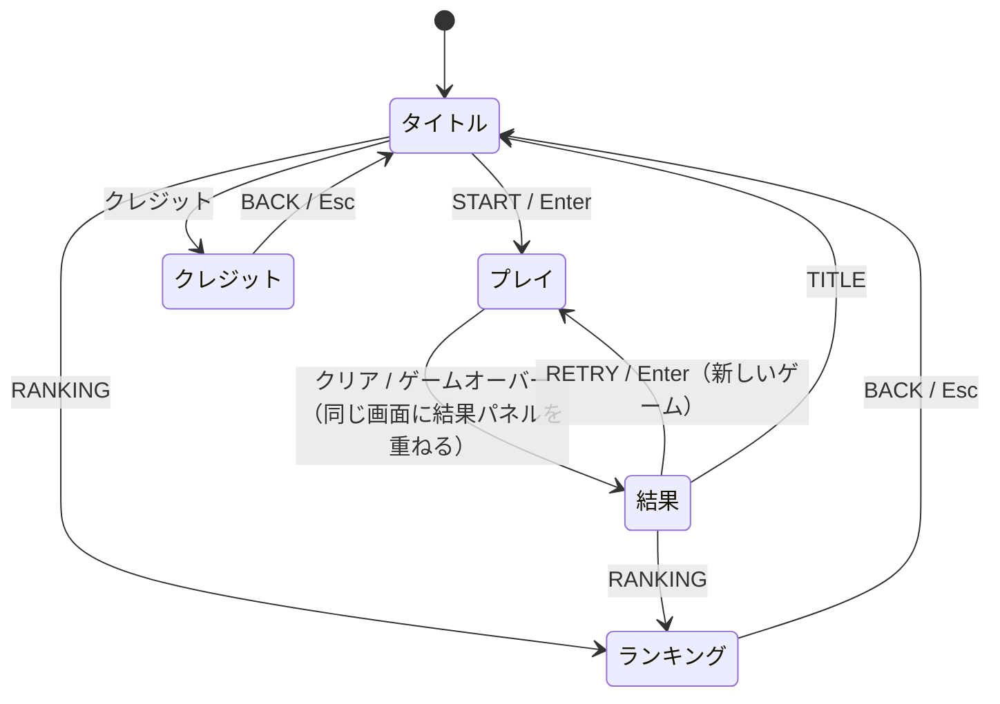

# GUI-0001 画面設計 共通

画面ごとの設計は次のとおり。この文書は、全画面に共通する決まりをまとめる。

| ID | 画面・部品 |
| --- | --- |
| [MBRK-GUI-0002](MBRK-GUI-0002-gui-design-ja.md) | タイトル画面 |
| [MBRK-GUI-0003](MBRK-GUI-0003-gui-design-ja.md) | プレイ画面（ゲーム領域・操作空間・操作欄・オーバーレイ） |
| [MBRK-GUI-0004](MBRK-GUI-0004-gui-design-ja.md) | 結果パネル（スコア登録を含む） |
| [MBRK-GUI-0005](MBRK-GUI-0005-gui-design-ja.md) | ランキング画面（バックアップを含む） |
| [MBRK-GUI-0006](MBRK-GUI-0006-gui-design-ja.md) | ダイアログと通知（インストール方法・読み込みの確認・更新・復旧・縦向きの案内） |
| [MBRK-GUI-0007](MBRK-GUI-0007-gui-design-ja.md) | クレジット画面 |

図の寸法は、基準の画面（幅 375 × 高さ 667、iPhone SE 相当）での CSS px。

## 1. 画面遷移



| 画面 | ページタイトル（`document.title`） | 初期フォーカス | 仕様書 |
| --- | --- | --- | --- |
| タイトル | ブロック崩し - タイトル | START ボタン | §8.2 |
| プレイ | ブロック崩し - プレイ | ゲーム領域（キー操作を受けるため） | §8.3 |
| 結果 | ブロック崩し - 結果 | PC：名前の入力欄 / スマホ：結果パネルの見出し | §8.3、§9.5 |
| ランキング | ブロック崩し - ランキング | 見出し「ハイスコアランキング」 | §8.4 |
| クレジット | ブロック崩し - クレジット | 見出し「クレジット」 | §8.8 |

- ランキング・クレジット画面から戻る先は、どこから来たかによらずタイトル（仕様書 §8）。
- 画面を切り替えたら、ページの先頭までスクロールを戻す。
- 画面の切替えは、`prefers-reduced-motion` が有効でなければ 150 ms のフェードにする（有効なら切替えは即時）。

## 2. レイアウト

```
┌──────────── 画面（幅 375）────────────┐
│ ↕ 上端の余白：max(10, 安全領域 + 24)  │
│ ┌───────── main（最大幅 480）───────┐ │
│ │←16→   内容（幅 343）        ←16→ │ │
│ └───────────────────────────────────┘ │
│ ↕ 下端の余白：max(16, 安全領域)       │
└───────────────────────────────────────┘
```

- `main` は最大幅 480 で中央寄せ。左右の余白は 16 と安全領域の大きい方（仕様書 §2.1 の PAGE_GUTTER）。
- 上端の余白は `simple_shogi` と同じ `--safe-top`（安全領域 + 24）。iPhone のホーム画面アプリで、ステータスバーの下に文字が入らないようにする。
- 横スクロールは、どの画面でも出さない。

## 3. 色（デザイントークン）

色は CSS の `:root` 変数だけで指定し、直書きしない。暗い配色で固定する（`color-scheme: dark`、ライトモードの切替えはしない）。仕様書 §3.4 の色に、画面の部品用の面と線の色を足した。

| 変数 | 値 | 使い道 |
| --- | --- | --- |
| `--bg` | #0B1020 | 画面全体の背景、`theme-color`、manifest の `background_color` |
| `--field` | #050814 | ゲーム領域の背景 |
| `--field-frame` | #3A4468 | ゲーム領域の外枠 |
| `--surface` | #141B2E | パネル（結果パネル・ダイアログ・表の行） |
| `--surface-2` | #1C2540 | 普通のボタン、入力欄 |
| `--border` | #3A4468 | 部品の枠線、区切り線 |
| `--text` | #E6EAF2 | 本文、HUD、パドル |
| `--muted` | #A0AABF | 補助の文字、ヒント |
| `--primary` | #4FC3F7 | 主ボタンの地、フォーカスの輪 |
| `--primary-text` | #0B1020 | 主ボタンの文字 |
| `--accent` | #FFD54F | 合計スコア、上位 3 位、自分の記録 |
| `--success` | #66BB6A | クリア |
| `--danger` | #FF6B6B | ゲームオーバー、入力エラー、危険のボタン |
| `--ball` | #FFFFFF | ボール |
| `--pause-veil` | rgb(11 16 32 / 0.75) | 一時停止の幕 |
| `--result-dim` | 50% | 終了後のゲーム領域の不透明度 |
| `--block-1`〜`--block-5` | #EF5350 / #FFA726 / #FFD54F / #66BB6A / #4FC3F7 | ブロックの行の色（上から） |

- 文字と背景のコントラストは 4.5:1 以上にする（`--muted` on `--bg` は約 8:1、`--primary-text` on `--primary` は約 10:1）。
- Canvas の描画も、起動時に CSS 変数から色を読んで使う（色の定義を 1 か所にするため）。

## 4. 文字

| 用途 | 書体 | 大きさ・太さ |
| --- | --- | --- |
| 本文・ボタン | `system-ui, -apple-system, 'Hiragino Sans', 'Noto Sans JP', sans-serif` | 16px / 標準。行の高さ 1.6 |
| 補助の文字 | 同上 | 14px |
| 画面の見出し | 同上 | 20px / 太字 |
| ロゴ「BREAKOUT」 | 等幅（`ui-monospace, 'SF Mono', Menlo, Consolas, monospace`） | 40px / 太字、字間 0.08em |
| 数字（スコア・タイム） | 等幅 | `font-variant-numeric: tabular-nums` |
| HUD・Canvas の文字 | 等幅 | 仕様書 §2.2 の値（論理座標） |

- Web フォントは使わない（オフラインで確実に表示するため。仕様書 §8.6）。
- 端末の文字サイズ設定で大きくなっても、ボタンの文字が切れずに折り返すようにする。

## 5. 共通の部品

### 5.1 ボタン

| 種類 | 見た目 | 使う所 |
| --- | --- | --- |
| 主ボタン | 地 `--primary`、文字 `--primary-text`、太字 | START、RETRY、REGISTER |
| 普通のボタン | 地 `--surface-2`、枠 `--border`、文字 `--text` | RANKING、クレジット、TITLE、BACK、記録の書き出し・読み込み など |
| トグルボタン | 普通のボタン + 状態の文字とアイコン。`aria-pressed` で状態を伝える | 一時停止、効果音 |
| リンク風ボタン | 枠なし、文字 `--primary`、下線 | インストール方法の入口 |
| 危険のボタン | 地 `--danger`、文字 `--primary-text`、太字（コントラスト約 7:1） | 記録の全消去の確認の「消す」 |

- 高さ 48 以上・幅 48 以上（仕様書 §8.1）。角丸 10。ボタンどうしの間隔は 8 以上。
- 押せない状態（`disabled`）は不透明度 50%、カーソルは既定。
- キーボードのフォーカスは `:focus-visible` で、`--primary` の 2px の輪を 2px 外側に出す。
- PC でキーのヒントを出すボタン（START・RETRY）は、ボタンの中に小さく `Enter` と表示する。タッチだけの端末（`(hover: none) and (pointer: coarse)`）では出さない。

### 5.2 入力欄

- 高さ 48、地 `--surface-2`、枠 `--border`、文字 16px（iPhone で入力時に拡大されないよう 16px 以上）。
- エラーのときは枠と補助の文字を `--danger` にし、`aria-invalid="true"` と `aria-describedby` で補助の文字を結び付ける。

### 5.3 アイコン

アイコンは SVG をコードに埋め込む（外部ファイル・絵文字は使わない。端末で見た目が変わらないようにするため）。線の太さ 2、大きさ 20 × 20、色は `currentColor`。すべて装飾として `aria-hidden="true"` にし、意味は隣の文字で伝える。

| 名前 | 形 | 使う所 |
| --- | --- | --- |
| check-circle | 丸の中にチェック | CLEAR |
| x-circle | 丸の中にバツ | GAME OVER |
| pause | 縦棒 2 本 | 一時停止ボタン（一時停止していないとき） |
| play | 右向きの三角 | 一時停止ボタン（一時停止中＝「再開」） |
| sound-on | スピーカー + 音の波 | 効果音ボタン（オン） |
| sound-off | スピーカー + バツ | 効果音ボタン（オフ） |
| arrow-left | 左向きの矢印 | BACK |
| download / upload | 下向き / 上向きの矢印と受け皿 | 記録の書き出し / 読み込み |
| install | 下向きの矢印とスマートフォン | インストール方法の入口 |

### 5.4 画面上部のバー（ランキング画面・クレジット画面）

`simple_shogi` の `.bar` と同じ形。左に BACK（矢印 + 「BACK」）、中央に見出し、右は空き（左右の釣り合いを取る）。

### 5.5 状態の表示

- 処理の結果（「n 位で登録しました」「記録を読み込みました（n 件）」など）は、操作した部品のすぐ下に `role="status"` の 1 行で出す。
- エラーは `--danger` の文字とアイコンで出す（色だけにしない）。

## 6. 読み上げ（共通）

- 画面の外に置く通知領域（`.sr-only`、`aria-live="polite"`）を 1 つ持ち、仕様書 §8.5 の文を出す。
- 画面を切り替えたら、初期フォーカスの部品にフォーカスを移す（§1 の表）。
- 装飾のアイコン・ロゴの飾りは `aria-hidden="true"`。

## 7. 動き

| 動き | 時間 | `prefers-reduced-motion: reduce` のとき |
| --- | --- | --- |
| 画面の切替え | 150 ms フェード | なし |
| 結果パネルの登場 | 200 ms で下から 16px 浮き上がる + フェード | なし |
| ボタンを押したとき | 押している間、明るさを 90% に | そのまま（動きではないため） |

ゲームの動き（ボール・パドル）は対象外（仕様書 §8.1）。
