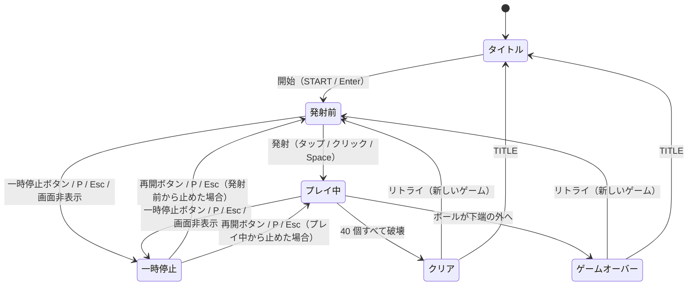

# ブロック崩しミニ 再現開発仕様書

- 版：1.1（2026-10-26）
- 対象：「ブロック崩しミニ」（アプリのバージョン 1.0.0。ゲーム本体 + 端末内ハイスコアランキング）を、別の環境で同じものとして作り直すための仕様
- 位置づけ：この 1 冊だけで再現できるようにまとめた仕様書。スマートフォンの縦画面で、ブラウザだけで動くアプリ（インストール可能・オフライン動作）として作る

### この仕様書の構成

| 部 | 章 | 決めること |
| --- | --- | --- |
| 第 1 部 製品仕様 | 1〜12 | **何を作るか**：ゲームのルール・物理・操作・画面・スコア・ランキング・効果音・PWA の振る舞い・数値パラメータ・受け入れ基準。`doc/specification.md` v1.4 と同じ内容 |
| 第 2 部 実装仕様 | 13〜30 | **どう作るか**：開発環境、技術構成、ファイル構成と層の決まり、主なデータ型、保存の形、効果音の音色、PWA の設定、テスト用の入口、テスト・CI・公開の手順 |

- 第 1 部と第 2 部が食い違ったときは、第 1 部を正とする。第 2 部は、第 1 部が「実装者が選ぶ」としたもの（§1.1）を、現在のリポジトリと同じ選択に固定する。
- 第 2 部の値は、このリポジトリの実装（`main`、2026-10-26 時点）から写したもの。
- 第 1 部を変えたときは、`doc/specification.md` も同じように変える（逆も同じ）。

### 改訂履歴

| 版 | 日付 | 内容 |
| --- | --- | --- |
| 1.0 | 2026-10-26 | 初版。第 1 部は `doc/specification.md` v1.4（改訂履歴は同ファイルを参照）。第 2 部は新規 |
| 1.1 | 2026-10-26 | 成果物の整合性の検査（`npm run check:docs`）を追加し、`verify` に入れた（§15.1・§16.1・§26.5・§27.1）。第 1 部は変更なし |

---

## 目次

**第 1 部 製品仕様**

1. [概要](#1-概要)
2. [フィールドと座標系](#2-フィールドと座標系)
3. [ゲームオブジェクト](#3-ゲームオブジェクト)
4. [操作仕様](#4-操作仕様)
5. [ゲームの進行と物理](#5-ゲームの進行と物理)
6. [スコア](#6-スコア)
7. [状態遷移](#7-状態遷移)
8. [画面仕様](#8-画面仕様)
9. [ハイスコアランキング](#9-ハイスコアランキング)
10. [非機能要件](#10-非機能要件)
11. [パラメータ一覧](#11-パラメータ一覧)
12. [受け入れ基準](#12-受け入れ基準)

**第 2 部 実装仕様**

13. [開発環境](#13-開発環境)
14. [技術構成](#14-技術構成)
15. [プロジェクトの設定](#15-プロジェクトの設定)
16. [ファイル構成と層](#16-ファイル構成と層)
17. [主なデータ型と関数](#17-主なデータ型と関数)
18. [画面の骨組みと画面切替え](#18-画面の骨組みと画面切替え)
19. [描画とレイアウト](#19-描画とレイアウト)
20. [入力](#20-入力)
21. [端末内保存](#21-端末内保存)
22. [効果音の音色](#22-効果音の音色)
23. [PWA（インストール・オフライン・更新・復旧）](#23-pwaインストールオフライン更新復旧)
24. [アイコン](#24-アイコン)
25. [テスト用の入口](#25-テスト用の入口)
26. [テスト](#26-テスト)
27. [CI と公開](#27-ci-と公開)
28. [再現の進め方](#28-再現の進め方)
29. [再現の確認](#29-再現の確認)
30. [別の環境に移すときの注意](#30-別の環境に移すときの注意)

---

# 第 1 部 製品仕様

## 1. 概要

1 ステージ・残機 1 のブロック崩しと、端末内に保存するハイスコアランキングで構成するゲームである。プレイヤーはパドルを左右に動かしてボールを打ち返し、40 個のブロックをすべて壊せばクリア、ボールを 1 回でも落とせばゲームオーバーとなる。

### 1.1 範囲

| 区分 | 内容 |
| --- | --- |
| 本仕様で定める | ゲームルール、物理と衝突判定、操作、画面と画面遷移、スコア計算、効果音、ランキングの登録・表示ルール、記録の書き出し・読み込み、インストール・オフライン動作・更新の要件、数値パラメータ |
| 実装者が選ぶ | 実装言語、描画 API、UI ライブラリ、端末内保存の方式、配置形態 |

### 1.2 前提

- **決定性**：ゲーム内に乱数はない。同じ入力列を同じタイミングで与えれば、同じ盤面とスコアになる（固定タイムステップで進めるため）。
- **ステージ・残機**：ステージは 1 つ、残機は 1。アイテム、耐久度のあるブロック、複数ボールはない。
- **通信しない**：サーバーを持たず、外部へデータを送らない。ランキングを含むすべての記録は、その端末（ブラウザ）の中だけに保存する。
- **想定する端末**：スマートフォンの縦画面を基準にする。タッチ操作で遊べることを必須とし、PC のマウス・キーボードでも遊べるようにする。
- **用語**
  - 論理座標：ゲーム内部の座標。単位は px。表示サイズに依存しない
  - ステップ：物理を 1 回進める単位時間（1/120 秒）
  - ポインタ：タッチ（指）・マウス・ペンをまとめた呼び方
  - タップ：ポインタを押してから離すまでの動きが小さい操作（§4.1-4）
  - 端末内保存：ブラウザに保存する仕組み（localStorage 等）。ブラウザの都合で消えることがある
  - アプリ識別子：同じサイトに載るほかのアプリと保存データを混ぜないための、このアプリ固有の名前

---

## 2. フィールドと座標系

ゲームは幅 480 × 高さ 640 の論理座標で動き、表示は縦横比 3:4 を保って拡大縮小する。物理計算はすべて論理座標で行う。

- 原点は左上、x は右向き、y は下向き。速度の単位は px/秒。
- 左壁 x = 0、右壁 x = 480、天井 y = 48（HUD 帯の下端）。**下端（y = 640）に壁はない。**

```
x=0                                        x=480
┌──────────────────────────────────────────┐ y=0
│ SCORE : 300                    TIME : 42 │  HUD 帯
├──────────────────────────────────────────┤ y=48（天井）
│                                          │
│  ■■ ■■ ■■ ■■ ■■ ■■ ■■ ■■                 │ y=88   1 行目
│  ■■ ■■ ■■ ■■ ■■ ■■ ■■ ■■                 │        …
│  ■■ ■■ ■■ ■■ ■■ ■■ ■■ ■■                 │ y=184  5 行目（下端 204）
│                                          │
│                    ●                     │  プレイ空間
│                                          │
│                ▀▀▀▀▀▀▀▀                  │ y=600〜612 パドル
│                                          │
└──────────────────────────────────────────┘ y=640（壁なし）

┌──────────────────────────────────────────┐
│                                          │  操作空間（タッチ端末だけ。§8.3）
└──────────────────────────────────────────┘

┌─────────────┐              ┌─────────────┐
│ 一時停止     │              │ 効果音：オン │  操作欄（§8.3）
└─────────────┘              └─────────────┘
```

| 領域 | y 範囲 | 内容 |
| --- | --- | --- |
| HUD | 0–48 | 左に `SCORE : <ブロック得点>`、右に `TIME : <経過秒（切り捨て）>` |
| ブロック帯 | 88–204 | 8 列 × 5 行のブロック |
| プレイ空間 | 204–600 | ボールが行き来する領域 |
| パドル | 600–612 | パドルはこの高さで左右にだけ動く |
| 落下域 | 612–640 | ここを通り越して下端の外に出たらミス |

**操作空間**：タッチ端末（主な入力が指の端末）では、ゲーム領域のすぐ下に、ゲーム領域と同じ幅・高さ 96 の「操作空間」を置く。ゲーム領域を指でなぞると、指でボールやパドルが隠れてしまうため、プレイ空間とは別に指を置く場所を設ける。操作空間はフィールド（論理座標）の外にあり、物理計算には関わらない。横方向の位置はゲーム領域と同じ変換（§2.1）で論理座標の x に直す。パソコン（マウス）では出さない。

### 2.1 表示サイズ

画面全体は最大幅 480 で中央寄せにする（§8.1）。ゲーム領域の表示サイズは次で決める。

- 利用可能幅 = min(画面幅, 480) − 32（左右の余白 16 ずつ）
- 利用可能高さ = 画面の表示領域の高さ − 上端の余白（安全領域を含む）− 操作空間（タッチ端末だけ。§2）の高さ − ゲーム領域の下の操作欄（§8.3）の高さ − 下端の安全領域
- 表示幅 = max(288, min(利用可能幅, 利用可能高さ × 3/4))
- 表示高さ = 表示幅 × 4/3
- 最小は論理サイズの 0.6 倍（288 × 384）。これより小さい画面では縦スクロールを許す（横スクロールは出さない）。最大は 448 × 約 597（画面幅 480 以上のとき）。
- 画面サイズや向きが変わったら即座に計算し直す。ただし **結果画面では、高さだけが変わった場合は計算し直さない**（名前入力でソフトウェアキーボードが出て表示領域が縮んでも、ゲーム領域が縮まないようにするため）。
- 高密度画面では実ピクセル密度に合わせて描画し、ぼやけさせない。
- ポインタ位置は「(画面上の x − 表示領域の左端) × 480 / 表示幅」で論理座標に変換する。

### 2.2 描画

毎フレーム全体を描き直す。描画順は次のとおり。

1. 背景（フィールド全面）
2. 外枠（線幅 2）
3. 生きているブロック
4. パドル
5. ボール
6. HUD（等幅太字 18、左右余白 16、上端 12。スコアは 3 桁区切り）
7. オーバーレイ
   - 発射前：「タップ / Space で発射」（中央より 80 下、14）
   - 一時停止中：フィールド全面に半透明の幕 +「PAUSED」（中央、太字 28）+「再開ボタン / P / Esc で再開」（中央より 36 下、14）

文字の大きさは論理座標での値。表示が縮小されても 0.6 倍（最小 14 × 0.6 ≒ 8.4px）までなので、読める大きさを保つ。

マウスで操作しているときは、ゲーム中のゲーム領域上のマウスカーソルを隠す。

---

## 3. ゲームオブジェクト

### 3.1 パドル

| 項目 | 値 |
| --- | --- |
| 幅 × 高さ | 80 × 12 |
| 上面の y | 600（固定） |
| 位置の持ち方 | 中心 x。初期値 240 |
| 移動範囲 | 中心 x を 40–440 に丸める（端が壁からはみ出さない） |
| 見た目 | 角丸半径 4 |

### 3.2 ボール

| 項目 | 値 |
| --- | --- |
| 半径 | 6 |
| 位置・速度 | 中心座標、速度ベクトル（px/秒） |
| 発射前 | パドル中央の真上（x = パドル中心、y = 600 − 6 − 1 = 593）に乗り、パドルに追従。速度 0 |

### 3.3 ブロック

- 8 列 × 5 行 = 40 個。各 幅 52 × 高さ 20、間隔 4。
- 左上座標：x = 18 + 列 × 56、y = 88 + 行 × 24（列・行は 0 始まり）。左右の余白はどちらも 18。
- ID = 行 × 8 + 列（0–39）。属性は生存フラグだけで、一度当たれば壊れる。
- 得点は行によらず 1 個 10 点。色だけ行ごとに変える。

### 3.4 配色（推奨）

暗い色で固定する（端末のライト / ダーク設定に合わせて変えない）。ブロックは行ごとに区別できれば変えてよい。

| 対象 | 色 |
| --- | --- |
| ブロック 1 行目（最上段） | #EF5350（赤） |
| ブロック 2 行目 | #FFA726（橙） |
| ブロック 3 行目 | #FFD54F（黄） |
| ブロック 4 行目 | #66BB6A（緑） |
| ブロック 5 行目 | #4FC3F7（青） |
| フィールド背景 | #050814 |
| 外枠 | #3A4468 |
| パドル | #E6EAF2 |
| ボール | #FFFFFF |
| HUD 文字 | #E6EAF2 |
| ヒント文字 | #A0AABF |
| 一時停止の幕 | rgba(11, 16, 32, 0.75) |
| 画面全体の背景（ゲーム領域の外）・テーマ色 | #0B1020 |
| 強調色（主ボタン） | #4FC3F7 |
| 強調色（合計スコア・上位 3 位・自分の記録） | #FFD54F |
| 成功（クリア） | #66BB6A |
| エラー（ゲームオーバー・入力エラー） | #FF6B6B |

---

## 4. 操作仕様

タッチで遊べることを基準とし、マウス・キーボードでも遊べる。パドルは「最後に使われた入力」に従う。キーは文字ではなく物理キー位置で判定する（キーボード配列や IME の状態に左右されない）。

| 操作 | タッチ | マウス・キーボード | 有効な状態 |
| --- | --- | --- | --- |
| パドル移動 | 操作空間またはゲーム領域を指でなぞる（押している間、指の x に追従） | マウス移動 / ← → / A D（押している間） | 発射前・プレイ中 |
| 発射 | 操作空間またはゲーム領域をタップ | ゲーム領域をクリック / Space | 発射前 |
| 一時停止・再開（トグル） | 一時停止ボタン | 一時停止ボタン / P / Esc | 発射前・プレイ中・一時停止中 |
| 自動一時停止 | 画面が非表示になる（アプリ切替え・タブ切替え・画面ロック等） | 同左 | 発射前・プレイ中 |
| 効果音のオン / オフ（トグル） | 効果音ボタン | 効果音ボタン | いつでも（ボタンがある画面） |
| 開始 | START ボタン | START ボタン / Enter | タイトル |
| リトライ | RETRY ボタン | RETRY ボタン / Enter | 結果 |
| タイトルへ戻る | BACK ボタン | BACK ボタン / Esc | ランキング・クレジット |

### 4.1 入力の細則

1. **キーボード移動**：向き dir = （右が押されていれば +1）−（左が押されていれば 1）。両方押しは停止。移動量 = dir × 420 px/秒 × ステップ時間。加速・慣性はない。
2. **ポインタ移動**：ポインタの x を論理座標に変換して 0–480 に丸め、パドル中心をその位置へ即座に合わせる（速度制限なし）。
   - タッチ・ペン：ゲーム領域内または操作空間内で押した時点から、離すまでの間だけ追従する。押した瞬間にもパドルを合わせる。押したまま指がその外に出ても、離すまで追従を続ける。ゲーム領域・操作空間の外（操作欄のボタンなど）で押した場合は追従しない。
   - マウス：ボタンを押していなくても、マウスを動かせば追従する。ポインタがゲーム領域の外にあっても追従する。
   - 複数の指が触れているときは、最初に触れた指だけを使う。
3. **入力元の切替え**：左右キーを押すと「キーボード」、ポインタを動かす（タッチなら押す・なぞる）と「ポインタ」が有効になる。どちらの場合もパドル中心は最後に 40–440 に丸める。
4. **発射要求**：
   - タップ・クリック：ゲーム領域内または操作空間内で押してから離すまでの移動が論理座標で 10 px 以内なら、離した時点で発射要求を出す。10 px を超えて動かした場合（パドルを動かした場合）は発射しない。これにより、発射前に指でパドルの位置を合わせてから、改めてタップで発射できる。
   - Space：押した時点で発射要求を出す。キーリピート（押しっぱなしによる自動連打）は無視する。
   - 発射要求は 1 回分だけ蓄え、次のステップで取り出したら消える。発射前以外での発射要求は何も起こさない。
5. **P / Esc** もキーリピートを無視する。
6. 一時停止時、ウィンドウがフォーカスを失ったとき、タッチが中断されたとき（OS による割り込み等）は、押下中の左右キーとタッチの追従をすべて「離した」扱いにする。再開時は一時停止中に出た発射要求を捨てる（再開した瞬間に発射しない）。
7. ゲーム中は ← → Space の既定動作（ページスクロール等）を抑止する。ゲーム領域と操作空間の上では、タッチによるスクロール・拡大・ダブルタップ拡大・長押しメニュー・文字選択を起こさない。ゲームが終わったらゲーム用の入力を受け付けるのをやめ、結果画面の操作を妨げない。
8. **結果画面の入力ガード**：結果画面が出てから 500 ミリ秒間は、Enter・Space と、結果パネル上のタップ・クリックを無効にする。プレイ中に押していたキーや指で、リトライや登録が意図せず動かないようにするためである。
9. **Enter の二重動作防止**：タイトル・結果画面で、ボタンや入力欄にフォーカスがあるときの Enter はその部品の動作だけを行い、画面全体の Enter（開始・リトライ）は動かさない。

---

## 5. ゲームの進行と物理

### 5.1 ゲームループ

- 物理は **固定タイムステップ 1/120 秒（約 8.333 ミリ秒）** で進める。描画はフレームごと（目標 60 fps）に 1 回。
- 各フレームで、前フレームからの実経過時間を蓄積器に足し、蓄積が 1 ステップ以上ある間ステップを繰り返す（浮動小数点誤差の許容値 1e-6 ミリ秒）。
- 1 フレームで足す実経過時間は **最大 100 ミリ秒** に制限する（復帰直後に大量のステップを進めてボールが物体をすり抜けるのを防ぐ）。
- ステップの途中で状態が発射前・プレイ中以外になったら、そのフレームの残りのステップは実行しない。
- ループは発射前・プレイ中の間だけ動かす。一時停止から再開するときは時刻の基準と蓄積器を初期化し、止まっていた時間を進めない。

### 5.2 1 ステップの処理順

状態が「発射前」「プレイ中」以外のときは何もしない。それ以外は次の順で処理する。

1. **パドル移動**（§4.1）
2. **発射前の場合**：ボールをパドル中央の真上（§3.2）に置く。発射要求があれば §5.3 の速度で発射し「プレイ中」へ移る。このステップはここで終わる（経過時間は増やさない）。
3. **プレイ中の場合**
   1. 経過時間にステップ時間を足す
   2. 現在の速さ `speed`（§5.8）を求める
   3. ボールを移動：位置 += 速度 × ステップ時間（秒）
   4. 壁との衝突（§5.4）
   5. パドルとの衝突（§5.5）。衝突した場合は最小垂直成分の補正（§5.7）を行う
   6. ブロックとの衝突（§5.6）
   7. 速度段階の更新（§5.8）
   8. クリア判定：壊したブロックが 40 個以上なら「クリア」。**クリアが成立したステップでは落下判定をしない**
   9. 落下判定：ボールの上端（y − 半径）が 640 を超えたら「ゲームオーバー」

### 5.3 発射

- 向きは垂直から右へ 20°（乱数なし）。
- 速度 = (speed × sin20°, −speed × cos20°)。初速 300 なら約 (102.61, −281.91)。

### 5.4 壁との衝突

向きは符号反転ではなく **絶対値で設定** する（境界付近で何度も反転して振動しないため）。

| 条件 | 位置の補正 | 速度 |
| --- | --- | --- |
| x − r < 0（左壁） | x = r | vx = \|vx\| |
| x + r > 480（右壁、左壁と排他） | x = 480 − r | vx = −\|vx\| |
| y − r < 48（天井） | y = 48 + r | vy = \|vy\| |

下端には壁がない。

### 5.5 パドルとの衝突

パドルの矩形 = (中心 x − 40, 600, 幅 80, 高さ 12)。重なりの判定は §5.9 の円と矩形の判定で行う。重なっていなければ何もしない。

**A. ボール中心 y ≤ 600（上面に当たった）**

- ボールが上向き（vy < 0）の場合：パドルが下から重なっただけなので、位置を y = 600 − r に押し出すだけで速度は変えない。
- それ以外：
  - offset = clamp((ボール x − パドル中心 x) / 40, −1, 1)
  - θ = offset × 60°
  - 速度 = (speed × sinθ, −speed × cosθ)、位置 y = 600 − r
  - 中央で真上、端ほど外向きに傾き、端で最大 60°。打ち返し前の向き・速さには依存しない。

**B. ボール中心 y > 600（側面・角に当たった）**

- ボールがパドル中心より左なら：x = パドル左端 − r、vx = −|vx|
- それ以外：x = パドル右端 + r、vx = |vx|
- vy はそのまま。

パドルと重なった場合は（A の押し出しだけの場合も含め）、最後に §5.7 の補正をかける。

### 5.6 ブロックとの衝突

1. 生きているすべてのブロックについて §5.9 の判定を行い、重なったブロックを集める。なければ終わり。
2. **重なったブロックはすべて同じステップで壊す**。壊した数 × 10 点をブロック得点に足す。
3. 反射は **最も深く重なった 1 個（代表ブロック）に対して 1 回だけ** 行う。深さが同じなら ID の小さい方を代表とする。
4. 代表ブロックに対するめり込み量 overlapX、overlapY（§5.9）で向きを決める。
   - overlapX ≤ overlapY なら **側面** として扱う
     - ボール x < ブロック中心 x なら x = ブロック左端 − r、vx = −|vx|
     - それ以外は x = ブロック右端 + r、vx = |vx|
   - overlapY ≤ overlapX なら **上下面** として扱う
     - ボール y < ブロック中心 y なら y = ブロック上端 − r、vy = −|vy|
     - それ以外は y = ブロック下端 + r、vy = |vy|
   - 両者が等しい（角）場合は両方を行う。
5. 最後に §5.7 の補正をかける（このときの speed は段階更新前の値）。

### 5.7 最小垂直成分の補正

ボールがほぼ水平に飛び続けるのを防ぐ。

- minVy = speed × 0.5（= cos60°）
- |vy| ≥ minVy なら何もしない。
- そうでなければ、
  - vy = 符号(vy) × minVy（vy < 0 なら −1、それ以外は +1）
  - vx = 符号(vx) × √(speed² − vy²)（vx < 0 なら −1、それ以外は +1）

速さは speed になり、各成分の符号は保たれる。

### 5.8 速度段階（加速）

| 壊したブロック数 | 段階 | 速さ（px/秒） |
| --- | --- | --- |
| 0–9 | 0 | 300 |
| 10–19 | 1 | 330 |
| 20–29 | 2 | 360 |
| 30–40 | 3 | 390 |

- 段階 = min(3, floor(壊した数 / 10))、速さ = 300 × (1 + 0.1 × 段階)
- 段階が変わったステップで、ボールの速度ベクトルを **向きを保ったまま** 新しい速さに合わせる。
- 1 ゲームの中で段階は下がらない。リトライで 0 に戻る。

### 5.9 円と矩形の重なり判定

中心 c、半径 r の円と、左上 (x, y)・幅 w・高さ h の矩形について次を求める。

- 最近点 n = (clamp(c.x, x, x + w), clamp(c.y, y, y + h))
- 距離 d = |c − n|
- **重なり = d < r**（接しているだけ、d = r は重なりに含めない）
- 深さ depth = r − d
- overlapX = min(c.x + r − x, x + w − (c.x − r))
- overlapY = min(c.y + r − y, y + h − (c.y − r))

---

## 6. スコア

| 項目 | 計算 |
| --- | --- |
| ブロック得点 | 壊したブロック数 × 10（0–400） |
| 経過時間 | プレイ中のステップでだけ増える。発射前・一時停止中は増えない |
| 時間ボーナス | クリア時：max(0, 180 − floor(経過ミリ秒 / 1000)) × 10。ゲームオーバー時は 0 |
| 合計スコア | ブロック得点 + 時間ボーナス（0–2,200） |

- 時間ボーナスの最大は 1,800（経過 1 秒未満でクリア）。180 秒以上かかると 0。
- HUD の SCORE はブロック得点を表示する（時間ボーナスは結果画面でだけ加算して見せる）。HUD の TIME は floor(経過ミリ秒 / 1000)。
- 得点はすべて 10 点単位になる。
- 数値は 3 桁区切りで表示する（例：1,250）。

**例**：95,789 ミリ秒でクリア → ブロック 400 + 時間ボーナス (180 − 95) × 10 = 850 → 合計 1,250。

---

## 7. 状態遷移

### 7.1 ゲームの状態



| 状態 | 説明 |
| --- | --- |
| タイトル | ゲームを始める前の画面 |
| 発射前 | ボールがパドルに乗っている。パドルは動かせる。経過時間は増えない |
| プレイ中 | ボールが動いている。経過時間が増える |
| 一時停止 | 物理も経過時間も止まる。どの状態から止めたかを覚え、再開時にその状態へ戻る |
| クリア / ゲームオーバー | ゲーム終了。結果画面を出す。物理は止まり、最後の盤面を暗く（不透明度 50%）表示し続ける |

### 7.2 規則

- 一時停止できるのは発射前とプレイ中だけ。それ以外での P / Esc は何もしない（ただしランキング画面の Esc は §8.4）。
- 画面が非表示になったときは「一時停止」にするだけで、表示に戻っても自動では再開しない。
- 「リトライ」「開始」は常に **新しいゲーム**（§3 の初期配置、得点・経過時間・速度段階 0）を作る。
- クリア判定はゲームオーバー判定より優先する（同じステップで両方の条件を満たしたらクリア）。
- ゲーム終了時には、結果・壊した数・ブロック得点・時間ボーナス・合計・経過ミリ秒をまとめた「結果サマリ」を作り、結果画面と登録に使う。
- 遊んでいる途中のゲームは保存しない。アプリを閉じたり読み込み直したりしたら、タイトルから始まる。

---

## 8. 画面仕様

画面は 5 つ。ゲーム・結果は同じ場所にあり、結果パネルはゲーム領域の上に重ねて表示する。

| 画面 | 入口 | ページタイトル |
| --- | --- | --- |
| タイトル | 起動時、結果画面の TITLE、ランキング・クレジットの BACK / Esc | ブロック崩しミニ - タイトル |
| プレイ | タイトルの START、結果画面の RETRY | ブロック崩しミニ - プレイ |
| 結果 | ゲーム終了 | ブロック崩しミニ - 結果 |
| ランキング | タイトル・結果画面の RANKING | ブロック崩しミニ - ランキング |
| クレジット | タイトルの「クレジット」（§8.8） | ブロック崩しミニ - クレジット |

存在しない画面へのアクセスはタイトルへ移す。

### 8.1 共通

- 画面全体は最大幅 480 で中央寄せ。暗い配色で固定（§3.4）。
- スマートフォンの縦画面を基準に作る。iPhone SE（幅 375）程度の小さい画面でも、横スクロールやはみ出しが出ないこと。
- ノッチ・ホームバー等の安全領域に内容が入り込まないよう、上下左右の余白に安全領域を含める。
- 横向きで、ゲーム領域が最小サイズ（§2.1）でしか表示できないときは、「縦向きでのプレイをおすすめします」と表示する（遊ぶことは妨げない）。
- ボタンは最小高さ 48（タップ領域 44 以上）。キーボードでも操作でき、フォーカス位置が見えること。
- ページ全体のピンチ拡大は許可する（ゲーム領域の上だけ §4.1-7 で抑止する）。
- 端末で「視差効果を減らす」が有効なときは、画面切替え等の装飾的なアニメーションを無効にする（ゲームの動きそのものは対象外）。

### 8.2 タイトル画面

- 見出し「ブロック崩しミニ」
- ボタン：START（PC では Enter のヒント付き。初期フォーカス）、RANKING、その下に「クレジット」（§8.8）
- 操作方法の一覧
  - パドル移動：画面の下をなぞる ／ マウス ／ ← → ・ A D
  - 発射：タップ ／ クリック ／ Space
  - 一時停止：一時停止ボタン ／ P ・ Esc
- 効果音ボタン（§8.7）
- **記録を全部消すボタン**（§9.2）：押すと確認を出し、「消す」を選んだらランキングの記録をすべて消す。取り消したら何も変えない。消し終わったら「記録を消しました」、書き込めなかったら「消せませんでした。もう一度お試しください」と表示する
- アプリのバージョン（例：`v1.0.0`）
- インストール方法の説明への入口（§8.6）

### 8.3 プレイ画面・結果画面

- タッチ端末では、ゲーム領域のすぐ下に **操作空間**（§2）を置く。なぞるとパドルが動き、タップで発射する（§4.1）。何をする場所か分かるよう、薄い文字で「ここをなぞって移動・タップで発射」と出す。
- ゲーム領域（タッチ端末では操作空間）の下に操作欄を置き、**一時停止ボタン** を出す。押すたびに一時停止と再開を切り替え、表示も「一時停止」⇔「再開」に変える。発射前・プレイ中・一時停止中だけ押せる。
- 操作欄には効果音ボタン（§8.7）も置く。押してもゲームは一時停止しない。
- ゲーム終了でゲーム領域を暗くし、その上に **結果パネル** を重ねて出す。パネルがゲーム領域に収まらないときは、パネルの中をスクロールできるようにする。

**結果パネル**

| 要素 | クリア | ゲームオーバー |
| --- | --- | --- |
| 見出し | 「CLEAR!」（成功色・アイコン付き） | 「GAME OVER」（エラー色・アイコン付き） |
| ブロック | ブロック得点 | — |
| 時間ボーナス | 時間ボーナス | — |
| 合計 | 合計スコア（大きく、強調色） | 合計スコア（大きく、強調色） |
| タイム | 経過秒を小数第 1 位で切り捨て（例：95,789 ms → 95.7 秒） | — |
| 壊したブロック | `n / 40` | `n / 40` |

- スコア登録エリア（§9.5）
- ボタン：RETRY（PC では Enter のヒント付き）、TITLE、RANKING
- 結果パネルは §4.1-8 の入力ガードを持つ。

### 8.4 ランキング画面

- 見出し「ハイスコアランキング」（初期フォーカス）
- この端末で登録した記録の上位 10 件の表。列：順位 / 名前 / スコア / 結果 / 登録日時

| 列 | 表示 |
| --- | --- |
| 順位 | 1–3 位は「1st」「2nd」「3rd」を強調色で、4 位以下は数字 |
| 名前 | 長い場合は省略記号で切り、全文は長押し・ツールチップ等で見られる |
| スコア | 3 桁区切り、右寄せ |
| 結果 | 「CLEAR」または「GAME OVER」。色だけでなくアイコンと文字で区別する |
| 登録日時 | 端末のタイムゾーンで `YYYY/MM/DD HH:mm`（24 時間制） |

- 画面幅が足りないときは、登録日時を名前の下に小さく表示するなど、行を 2 段にしてよい（横スクロールは出さない）。
- **自分の記録**：この端末で直前に登録した記録（§9.5 で保存した id）と一致する行を背景色と左端の帯で強調し、名前の後ろに「（あなた）」を付ける。
- 状態別の表示
  - 読み込み失敗（端末内保存が使えない等）：「ランキングを読み込めませんでした」+「再読み込み」ボタン
  - 0 件：「まだ記録がありません」+「タイトルへ戻る」ボタン
- 記録のバックアップ（§9.6）：「記録を書き出す」「記録を読み込む」ボタン
- BACK ボタンまたは Esc でタイトルへ戻る。
- 画面を開くたびに端末内保存から読み直す。

### 8.5 アクセシビリティ

- ゲーム領域には「ブロック崩しミニのゲーム画面」という代替テキストを付ける。
- 一時停止ボタンと効果音ボタンは、押された状態（一時停止中か・効果音がオンか）を支援技術に伝える。
- 効果音だけで情報を伝えない。効果音で知らせる出来事は、画面表示か読み上げでも分かるようにする。
- 次の出来事を支援技術向けに読み上げる（画面上には出さない通知領域を使う）。
  - スコアが変わった：「スコア 120」
  - 一時停止：「一時停止しました。再開ボタンで再開します」／再開：「再開しました」
  - ゲーム終了：「クリア。スコア 1,250」／「ゲームオーバー。スコア 120」
- 利用者が入力した文字（名前）は、文字として表示し、HTML として解釈させない。

### 8.6 インストール・オフライン・更新

- **インストール可能**：ホーム画面に追加してアプリのように開ける（名前「ブロック崩しミニ」・アイコン・テーマ色を持つ）。
- **オフライン動作**：一度開いたあとは、通信がなくても起動から登録・ランキング表示まで、すべての機能が使える。外部のリソース（Web フォント・外部のスクリプト等）に頼らない。
- **インストール方法の入口**：タイトル画面に置く。iPhone / iPad（Safari：共有 → ホーム画面に追加）、Android（Chrome：メニュー → アプリをインストール）、パソコン（Chrome / Edge：アドレスバーのインストールのマーク）の 3 つの手順を載せ、今使っている端末の説明を最初から開いておく。ブラウザがインストールの案内に対応しているときは「今すぐインストール」ボタンも出す。すでにインストールしたアプリとして開いているときは、入口を出さない。
- **更新**：新しい版が届いても勝手に切り替えず、「更新」ボタンを出して利用者が切り替える。プレイ中に画面が読み込み直されることはない。
- **バージョン表示**：タイトル画面にバージョンを出し、更新が反映されたかをひと目で確認できるようにする。
- **起動失敗からの復旧**：古いキャッシュとの食い違い等で起動できなかったときは、このアプリのキャッシュだけを消して読み込み直す。保存データ（ランキング等）は消さない。

### 8.7 効果音

ゲーム中の出来事を短い効果音で知らせる。音はアプリの中で合成し、音声ファイルを持たない（オフラインで確実に鳴らすため。素材のライセンスの心配もなくなる）。

**鳴らす出来事**

| 出来事 | きっかけ | 音の印象（目安） |
| --- | --- | --- |
| 発射 | 発射前 → プレイ中（§5.2-2） | 短く上がる音 |
| パドルで打ち返す | パドルとの衝突（§5.5）。押し出しだけ（A の vy < 0）の場合は鳴らさない | 低めの「ポン」 |
| 壁・天井で跳ね返る | 壁との衝突（§5.4） | ごく短く小さい「コッ」 |
| ブロックを壊す | ブロックとの衝突（§5.6） | 高めの「カン」。行ごとに音の高さを変え、上の行ほど高くする |
| 加速 | 速度段階が上がった（§5.8） | 短い 2 音の上昇 |
| クリア | 状態がクリアになった | 明るい短いフレーズ（1 秒程度） |
| ゲームオーバー | 状態がゲームオーバーになった | 下がっていく短いフレーズ（1 秒程度） |
| 登録成功 | スコア登録に成功した（§9.5） | 短い確認音 |

**規則**

- 1 ステップ（§5.2）の中で同じ種類の出来事が何回起きても、その種類の音は 1 回だけ鳴らす（例：2 個のブロックを同時に壊しても「カン」は 1 回。高さは代表ブロックの行で決める）。
- 1 フレームの中で複数のステップが進んだ場合も、同じ種類の音はそのフレームで 1 回だけにする（音が重なって大きくなりすぎないため）。
- 同じステップで加速とブロック破壊が起きたら両方鳴らす。クリア・ゲームオーバーが起きたステップでは、ほかの音は鳴らさずクリア・ゲームオーバーの音だけを鳴らす。
- 効果音は物理と得点に影響しない。鳴らせない環境（音の機能が使えない・初期化に失敗した）でも、ゲームはそのまま動く。
- 一時停止したとき、画面が非表示になったときは、鳴っている音を止める。
- 音量は控えめにそろえる。端末の音量に従い、アプリ内の音量調整は設けない。
- スマートフォンのブラウザは、利用者が画面に触れるまで音を出せないことがある。最初のタップ・クリック・キー入力（START ボタン等）のときに音の機能を使える状態にする。

**オン / オフ設定**

- 効果音ボタンで、オンとオフを切り替える。表示は「効果音：オン」／「効果音：オフ」とし、アイコンだけにしない。
- 置き場所：タイトル画面と、プレイ画面の操作欄（§8.3）。
- 初期値はオン。設定は端末内に保存し、次に開いたときも引き継ぐ。保存できなくても、そのとき開いている間は設定が効く。
- オフに切り替えたら、鳴っている音もすぐに止める。
- この設定は記録のバックアップ（§9.6）には含めない。

### 8.8 クレジット画面

- タイトル画面の RANKING の下の「クレジット」ボタンで開く。
- 見出し「クレジット」（初期フォーカス）。BACK ボタンまたは Esc でタイトルへ戻る。
- 次の役職と名前を、上から順に中央揃えで表示する（役職ごとに間を空ける）。

| 役職 | 名前 |
| --- | --- |
| PRODUCER | YOSHIHARU TSUKUDA |
| DIRECTOR | YOSHIHARU TSUKUDA |
| GAME DESIGNER | YOSHIHARU TSUKUDA |
| GRAPHIC DESIGNER | CLAUDE CODE |
| SOUND CREATOR | CLAUDE CODE |
| PROGRAMMER | CLAUDE CODE |

- 文字は文字として表示する（画像にしない。読み上げで読めるようにするため）。

---

## 9. ハイスコアランキング

ランキングは端末内保存に置き、その端末（ブラウザ）で遊んだ記録だけを扱う。ほかの端末やほかの人とは共有しない。

### 9.1 記録のデータ項目

| 項目 | 型 | 制約 |
| --- | --- | --- |
| id | 整数 | 端末内で採番。1 から始まり、登録のたびに 1 増える一意の値（記録が消えても番号は再利用しない） |
| playerName | 文字列 | 前後の空白を除いて 1–12 文字（§9.3） |
| score | 整数 | 0–2,200 |
| result | 列挙 | `cleared` または `gameOver` |
| createdAt | 日時 | 登録時の端末の時刻。ミリ秒精度、UTC、ISO 8601 の文字列で保存 |

保存するもの：

| 名前 | 内容 |
| --- | --- |
| 記録一覧 | 上位 10 件まで（§9.4 の並び順） |
| 次の id | 次に採番する id |
| 前回の名前 | 最後に登録に成功した名前（§9.5 の初期値） |
| 自分の記録 id | 最後に登録した記録の id（§8.4 の「あなた」表示） |

ランキングとは別に、効果音のオン / オフ設定（§8.7）も端末内に保存する。

- 保存データには版番号を持たせる。保存の形を変えるときは版を上げ、古い形のデータを新しい形に移行する（古い記録を捨てない）。
- 保存の名前（キー）にはアプリ識別子を付け、同じサイトに載るほかのアプリと混ざらないようにする。
- 端末の時刻が戻されると、日時の順序が実際の登録順とずれることがある。並び順は §9.4 のとおり id で決着するので、壊れはしない。

### 9.2 操作

| 操作 | 入力 | 結果 |
| --- | --- | --- |
| 登録 | 名前、結果サマリ（score、result） | 記録を作って順位を求め、上位 10 件に入れば保存する。順位（または圏外）を返す |
| 上位取得 | なし | 並び順のとおりに最大 10 件。各要素は記録 + rank（1 始まりの連番）。0 件なら空の一覧 |
| 書き出し・読み込み | §9.6 | §9.6 |
| 全消去 | なし | 記録一覧を空にし、自分の記録 id を消す。次の id・前回の名前・効果音の設定は残す（id は再利用しないため）。書き込めなかったら、何も変えずに失敗を返す |

### 9.3 入力の規則

画面での入力と、記録の読み込み（§9.6）の両方で同じ規則を使う。

**名前**

1. 前後の空白を除く。
2. 文字数は **Unicode コードポイント単位** で数える（「𠮷」も 1 文字）。
3. 0 文字 → `empty`（「名前を入力してください」）
4. 制御文字（Unicode 一般カテゴリ Cc）または書式文字（Cf：ゼロ幅文字、結合子、方向制御など）を含む → `invalidChar`（「使用できない文字が含まれています」）
5. 12 文字を超える → `tooLong`（「12 文字以内で入力してください」）
6. 判定順は 3 → 4 → 5。保存するのは空白を除いた後の値。

**スコア**

- 0–2,200 の整数
- result は `cleared` / `gameOver` のどちらか
- **結果との整合性**（読み込むファイルの書き換えを見つけるため）
  - 10 の倍数であること
  - `gameOver` なら 400 以下（時間ボーナスがないため）
  - `cleared` なら 400 以上（全ブロックを壊しているため）

### 9.4 順位の決め方

- 並び順：score 降順 → createdAt 昇順（同点なら先に登録した方が上）→ id 昇順。
- 登録時の順位 = 「保存済みの記録のうち、自分より上位の記録数」+ 1。上位とは次のいずれか。
  - score が自分より高い
  - score が同じで createdAt が自分より前
  - score と createdAt が同じで id が自分より小さい
- 順位が 10 以内なら記録一覧に入れ、11 位以下になった記録を一覧から外す。順位が 11 以上なら記録一覧には入れない（圏外）。

### 9.5 結果画面のスコア登録

- クリア・ゲームオーバーのどちらでも登録できる。登録は任意。
- 名前入力欄と REGISTER ボタン。PC では入力欄に初期フォーカスを置き、カーソルを末尾にする。スマートフォンでは、画面を開いただけでソフトウェアキーボードが出ないよう、入力欄に自動でフォーカスを置かない。
- 入力欄の初期値は、この端末で前回登録に成功した名前（なければ空）。
- 補助表示：通常は「1〜12 文字」、右側に `現在の文字数 / 12`（前後の空白を除いて数える）。
- エラー表示：規則違反を入力中に即時表示する。ただし `empty` は、一度入力欄からフォーカスが外れた後にだけ表示する。
- 規則を満たさない間と登録済みの間は REGISTER を押せない。
- **二重登録の防止**：登録に成功したら入力欄とボタンを無効にし、同じ結果を再登録できない。
- 成功時：
  - 10 位以内：「n 位で登録しました」
  - 圏外：「ランキング外でした（上位 10 件に入りませんでした）」
  - どちらの場合も、RETRY ボタンにフォーカスを移し、「前回の名前」を保存する。10 位以内のときは「自分の記録 id」も保存する。
- 失敗時（端末内保存が使えない・容量不足等）：
  - 「保存できませんでした。もう一度お試しください」を表示し、再度 REGISTER を押せる。
  - ゲームそのものは続けて遊べる。

### 9.6 記録の書き出し・読み込み（バックアップ）

端末内保存はブラウザの都合で消えることがある（特に iPhone）ため、記録をファイルに書き出して保管し、読み込んで戻せるようにする。

**書き出し**

- ランキング画面の「記録を書き出す」で、JSON ファイルを端末に保存する。ファイル名は `<アプリ識別子>-backup-YYYYMMDD.json`（日付は端末のタイムゾーン）。
- 中身の例：

```json
{
  "app": "<アプリ識別子>",
  "schemaVersion": 1,
  "exportedAt": "2026-10-23T03:15:00.123Z",
  "nextId": 43,
  "lastPlayerName": "TSUKU",
  "lastRecordId": 42,
  "scores": [
    { "id": 42, "playerName": "TSUKU", "score": 1250, "result": "cleared",
      "createdAt": "2026-10-23T03:15:00.123Z" }
  ]
}
```

**読み込み**

- ランキング画面の「記録を読み込む」でファイルを選ぶ。今の記録は **置き換わる** ので、「今の記録は置き換わります。読み込みますか？」と確認してから行う。
- 次の場合は読み込まず、理由を表示する。今の記録は変えない。

| 状況 | 表示 |
| --- | --- |
| JSON として読めない・必須の項目がない | 「記録のファイルとして読み込めませんでした」 |
| `app` がこのアプリの識別子と違う | 「別のアプリの記録です」 |
| `schemaVersion` がこのアプリの版より新しい | 「新しい版のアプリで書き出した記録です。アプリを更新してから読み込んでください」 |
| 記録の 1 件でも §9.3 の規則に合わない、id が重複している | 「記録の内容が正しくありません」 |

- `schemaVersion` が古い場合は、§9.1 の移行をしてから読み込む。
- 記録が 10 件を超えていたら、§9.4 の並び順で上位 10 件だけを残す。
- `nextId` が記録の最大 id 以下なら、最大 id + 1 にそろえる。
- 成功したら「記録を読み込みました（n 件）」を表示し、ランキングの表を読み直す。

---

## 10. 非機能要件

| 項目 | 目標 |
| --- | --- |
| フレームレート | 一般的なスマートフォン（例：iPhone SE 第 2 世代、Pixel 7）とデスクトップの最新ブラウザで、プレイ中 60 fps を維持する（最高速度・スコア更新中も） |
| 物理の安定性 | 表示フレームレートが変わっても、物理は 1/120 秒刻みで同じ結果になる |
| 入力の遅れ | 指やマウスを動かしてから、パドルの表示が追いつくまで 1 フレーム以内 |
| 入力デバイス | タッチ（必須）、マウス・キーボード（対応） |
| 効果音の遅れ | 出来事が起きてから音が鳴るまで、体感で遅れを感じない（目安 50 ミリ秒以内） |
| 対応ブラウザ | iPhone の Safari、Android の Chrome、パソコンの Chrome / Edge の最新版 |
| オフライン | 一度開いたあとは、通信なしですべての機能が動く（§8.6） |
| 通信・個人情報 | 外部へデータを送らない。名前は端末の中にだけ保存する |
| 端末内保存の失敗 | 端末内保存が使えない・容量超過でも、ゲームは遊べる（登録・ランキングは §8.4・§9.5 のエラー表示になる） |

---

## 11. パラメータ一覧

| 名前 | 値 | 単位 | 説明 |
| --- | --- | --- | --- |
| FIELD_WIDTH | 480 | px | フィールド幅 |
| FIELD_HEIGHT | 640 | px | フィールド高さ |
| HUD_HEIGHT | 48 | px | HUD 帯の高さ（天井の y） |
| STEP | 1000/120 | ms | 固定タイムステップ |
| MAX_FRAME | 100 | ms | 1 フレームで進める時間の上限 |
| PADDLE_WIDTH | 80 | px | パドル幅 |
| PADDLE_HEIGHT | 12 | px | パドル高さ |
| PADDLE_Y | 600 | px | パドル上面の y |
| PADDLE_SPEED | 420 | px/秒 | キーボード操作時のパドル速度 |
| BALL_RADIUS | 6 | px | ボール半径 |
| BALL_INITIAL_SPEED | 300 | px/秒 | 初速 |
| LAUNCH_ANGLE | 20 | 度 | 発射角（垂直から右へ） |
| MAX_BOUNCE_ANGLE | 60 | 度 | パドル端での最大反射角（垂直から） |
| MIN_VY_RATIO | 0.5 | — | 速さに対する垂直成分の最小比 |
| BLOCK_COLS × BLOCK_ROWS | 8 × 5 | 個 | ブロック配置（計 40） |
| BLOCK_WIDTH × BLOCK_HEIGHT | 52 × 20 | px | ブロック寸法 |
| BLOCK_GAP | 4 | px | ブロック間隔 |
| BLOCK_OFFSET_X | 18 | px | 1 列目の左端 |
| BLOCK_OFFSET_Y | 88 | px | 1 行目の上端 |
| POINTS_PER_BLOCK | 10 | 点 | ブロック 1 個の得点 |
| SPEED_STEP_BLOCKS | 10 | 個 | 加速する破壊数の刻み |
| SPEED_STEP_RATIO | 0.1 | — | 1 段階あたりの加速率（初速比） |
| MAX_SPEED_LEVEL | 3 | — | 速度段階の上限 |
| TIME_BONUS_BASE | 180 | 秒 | 時間ボーナスの基準秒数 |
| TIME_BONUS_PER_SEC | 10 | 点 | 1 秒あたりの時間ボーナス |
| MAX_SCORE | 2,200 | 点 | 合計スコアの上限 |
| TAP_MAX_MOVE | 10 | px（論理） | タップとみなす、押してから離すまでの最大移動量 |
| RESULT_INPUT_GUARD | 500 | ms | 結果画面で Enter・Space・タップを無効にする時間 |
| CONTROL_AREA_HEIGHT | 96 | px（画面） | 操作空間の高さ（タッチ端末だけ） |
| PLAYER_NAME_MAX | 12 | 文字 | 名前の最大文字数（コードポイント） |
| RANKING_LIMIT | 10 | 件 | 保存・表示するランキングの件数 |
| PAGE_MAX_WIDTH | 480 | px（画面） | 画面全体の最大幅 |
| PAGE_GUTTER | 16 | px（画面） | ゲーム領域の左右の余白 |
| MIN_TAP_TARGET | 44 | px（画面） | タップできる部品の最小の大きさ |
| DISPLAY_MIN_SCALE | 0.6 | — | 表示の最小倍率 |
| SOUND_DEFAULT | オン | — | 効果音の初期設定 |

---

## 12. 受け入れ基準

再現実装は、次をすべて満たすこと。

### 12.1 ゲーム

- [ ] 開始直後、パドル中心 x = 240、ボール中心 (240, 593)、ブロック 40 個、得点 0、TIME 0
- [ ] 発射前はボールがパドルに追従し、TIME が増えない
- [ ] 発射直後の速度が約 (102.61, −281.91) px/秒
- [ ] パドル中央で打ち返すと真上、端で打ち返すと垂直から 60° に飛ぶ
- [ ] 左右の壁と天井（y = 48）で跳ね返り、下端では跳ね返らない
- [ ] パドルを左右の壁より外に出せない（中心 40–440）
- [ ] 2 個のブロックに同時に触れたら 2 個とも壊れ、20 点入り、反射は 1 回だけ
- [ ] 10・20・30 個目を壊した時点で速さが 330・360・390 px/秒になり、向きは変わらない
- [ ] ボールの垂直成分の大きさが常に速さの 0.5 倍以上
- [ ] 40 個壊すとクリア、ボールが下端の外に出るとゲームオーバー
- [ ] 最後のブロックを壊したステップでボールが下端の外に出ても、クリアになる
- [ ] 同じ入力列から同じ結果になる（乱数がない）

### 12.2 操作

- [ ] ゲーム領域を指でなぞるとパドルが指の x に追従し、指を離すと止まる
- [ ] タッチ端末では、ゲーム領域の下に操作空間が出て、そこをなぞってもパドルが指の x に追従し、タップで発射できる。パソコンでは操作空間が出ない
- [ ] 発射前に指でパドルを動かして離しても発射されず、そのあとのタップで発射される
- [ ] ゲーム領域・操作空間を指でなぞっている間、ページがスクロール・拡大しない
- [ ] マウス・← → / A D でもパドルを動かせ、最後に使った入力に従う
- [ ] Space の押しっぱなしで連続発射されない
- [ ] 一時停止ボタン・P / Esc で一時停止・再開でき、一時停止中は TIME が増えない
- [ ] 別のアプリやタブに切り替えると自動で一時停止し、戻っても自動では再開しない
- [ ] 一時停止中に Space を押しても、再開した瞬間に発射されない
- [ ] 結果画面の表示から 500 ms 以内の Enter・Space・タップではリトライ・登録が動かない

### 12.3 スコア・結果

- [ ] 95,789 ms でクリアすると、ブロック 400、時間ボーナス 850、合計 1,250、タイム 95.7 秒と表示される
- [ ] 180 秒以上かかったクリアの時間ボーナスが 0
- [ ] ゲームオーバーの合計がブロック得点と等しく、時間ボーナス・タイムの行が出ない

### 12.4 ランキング

- [ ] 名前「 TSUKU 」は「TSUKU」として登録される
- [ ] 13 文字の名前、空の名前、ゼロ幅文字を含む名前は登録できない
- [ ] 「𠮷」を 12 個並べた名前は登録できる
- [ ] 同点の記録は先に登録した方が上位になり、登録時に表示する順位とランキング画面の順位が一致する
- [ ] 10 件ある状態で 10 位の記録より低いスコアを登録すると「ランキング外でした」と表示され、一覧は変わらない
- [ ] 10 件ある状態で上位に入る記録を登録すると、元の 10 位が一覧から外れる
- [ ] 登録成功後は同じ結果を再登録できず、「n 位で登録しました」が出る
- [ ] ランキング画面で直前に登録した記録に「（あなた）」が付く
- [ ] アプリを閉じて開き直しても、ランキングと前回の名前が残っている
- [ ] 0 件・読み込み失敗の各表示が出る
- [ ] 端末内保存が使えない状態でも、ゲームを最後まで遊べ、登録時に「保存できませんでした」が出る
- [ ] タイトル画面の「記録を全部消す」で確認を出し、「消す」でランキングが 0 件になる。取り消すと何も変わらない。前回の名前と効果音の設定は残る

### 12.5 記録のバックアップ

- [ ] 書き出したファイルを読み込むと、同じランキングと「（あなた）」表示に戻る
- [ ] 別のアプリのファイル、新しすぎる版のファイル、壊れたファイルは、理由を表示して読み込まず、今の記録も変わらない
- [ ] score 401 + gameOver、score 390 + cleared、score 1,255 を含むファイルは「記録の内容が正しくありません」で読み込まない
- [ ] 読み込みの前に確認が出て、取り消すと何も変わらない

### 12.6 効果音

- [ ] 発射・パドル・壁・ブロック・加速・クリア・ゲームオーバー・登録成功で、それぞれの効果音が鳴る
- [ ] 2 個のブロックを同時に壊しても、ブロックの音は 1 回だけ鳴る
- [ ] 最後のブロックを壊したステップでは、クリアの音だけが鳴る
- [ ] 効果音ボタンでオフにすると、以後どの出来事でも鳴らず、鳴っている音も止まる
- [ ] 効果音の設定は、アプリを開き直しても引き継がれる
- [ ] 初めて開いたときの効果音はオン
- [ ] 音の機能が使えない環境でも、ゲームを最後まで遊べる

### 12.7 画面・インストール

- [ ] 幅 375 × 高さ 667（iPhone SE 相当）と幅 412 × 高さ 915（Pixel 7 相当）の縦画面で、横スクロールやはみ出しがなく、ゲーム領域・操作空間・一時停止ボタンが 1 画面に収まる
- [ ] 結果画面で名前を入力するためにソフトウェアキーボードが出ても、ゲーム領域の大きさが変わらない
- [ ] タップできる部品がすべて 44 px 以上
- [ ] タイトル画面にバージョンとインストール方法の入口が出る（インストールしたアプリとして開いたときは入口が出ない）
- [ ] 一度開いたあと、通信を切っても起動・プレイ・登録・ランキング表示ができる
- [ ] 新しい版を公開しても、プレイ中に画面が切り替わらず、「更新」ボタンを押すと新しい版になる
- [ ] タイトル画面の「クレジット」でクレジット画面が開き、§8.8 の役職と名前が中央揃えで出る。BACK・Esc でタイトルに戻る

---

# 第 2 部 実装仕様

## 13. 開発環境

| 項目 | 内容 |
| --- | --- |
| OS | 問わない（Windows・macOS・Linux）。CI は ubuntu-latest |
| Node.js | 24 系 |
| パッケージ管理 | npm（`package-lock.json` をコミットし、`npm ci` で入れる） |
| E2E のブラウザ | Playwright の Chromium（`npx playwright install chromium`） |
| 実機の確認 | iPhone の Safari、Android の Chrome（E2E は Chromium だけなので、iPhone は実機で確かめる） |
| 公開先 | GitHub Pages（サブパス配信。例：`https://<ユーザー>.github.io/mini-blockbreaking-game/`） |

サーバー・データベース・外部 API は使わない。静的ファイルを配信できればどこでも動く。

---

## 14. 技術構成

### 14.1 使うもの

| 区分 | 採用 | 版（`package.json` の指定） |
| --- | --- | --- |
| 言語 | TypeScript（strict） | `~6.0.3` |
| ビルド・開発サーバー | Vite | `^8.3.4` |
| PWA | vite-plugin-pwa（Workbox） / workbox-window | `^2.0.0` / `^7.4.1` |
| 単体テスト | Vitest（node 環境） | `^5.0.3` |
| E2E | Playwright | `^1.64.0` |
| 静的検査 | ESLint + typescript-eslint（flat config） | `^10.12.0` / `^8.71.1` |
| その他 | `@eslint/js` `^10.0.1`、`globals` `^17.13.0`、`@types/node` `^24.19.2` | |

- **実行時の依存はない**（`dependencies` は空。すべて `devDependencies`）。UI フレームワーク・ゲームエンジン・音声ファイル・Web フォント・外部 CDN は使わない。
- 描画は Canvas 2D、効果音は Web Audio の合成、保存は localStorage。

### 14.2 選んだ理由（要約）

| 決定 | 理由 | 元の記録 |
| --- | --- | --- |
| サーバーを持たず、端末内に保存 | 運用・費用・個人情報の扱いをなくす | ADR-0001 |
| 構成とルールを simple_shogi に合わせる | 同じ作者のプロジェクトで道具と手順を共通にする | ADR-0002 |
| ゲーム領域は Canvas 2D | 毎フレーム全体を描き直す決まり（§2.2）に合う | ADR-0003 |
| ロジックを純関数にし、固定タイムステップ | 決定性（§1.2）と単体テストのしやすさ | ADR-0004 |
| 効果音は Web Audio で合成 | オフラインで確実に鳴る、素材のライセンスが不要 | ADR-0005 |
| localStorage と JSON の書き出し | 記録が小さい（最大 10 件）。消えたときはファイルで戻す | ADR-0006 |
| アプリ識別子 `mini-blockbreaking-game` | 同じサイトのほかのアプリと保存・キャッシュを分ける | ADR-0007 |
| E2E は Chromium × 2 画面、iPhone は実機 | CI で動かせる範囲と、実機でしか分からないものを分ける | ADR-0008 |

---

## 15. プロジェクトの設定

### 15.1 `package.json`

```json
{
  "name": "mini-blockbreaking-game",
  "version": "1.0.0",
  "private": true,
  "type": "module",
  "scripts": {
    "dev": "vite",
    "build": "tsc --noEmit && vite build",
    "preview": "vite preview",
    "typecheck": "tsc --noEmit",
    "lint": "eslint .",
    "test": "vitest run",
    "test:e2e": "playwright test",
    "check:dist": "node scripts/check-dist.mjs",
    "check:docs": "node scripts/check-docs.mjs",
    "icons": "node scripts/make-icons.mjs",
    "verify": "npm run lint && npm run check:docs && npm test && npm run build && npm run check:dist"
  }
}
```

- `name` が **アプリ識別子**、`version` が **画面に出すバージョン** になる（§15.2）。この 2 つ以外の場所に書かない。

### 15.2 `vite.config.ts` の要点

| 設定 | 値 | 理由 |
| --- | --- | --- |
| `base` | `'./'` | GitHub Pages のサブパスでも動く相対パス |
| `define.__APP_VERSION__` | `package.json` の `version` | タイトル画面の `v1.0.0` |
| `define.__APP_ID__` | `package.json` の `name` | 保存のキー・バックアップの `app`・復旧の範囲 |
| 独自プラグイン `app-id-meta` | `index.html` の `__APP_ID__` を識別子に置き換える | ビルドを通らない `public/boot.js` が `<meta name="app-id">` から読むため |
| `VitePWA` | §23.1 | |
| `test` | `{ environment: 'node', include: ['tests/**/*.test.ts'] }` | 単体テストはロジック層だけ（DOM 不要） |

アプリ名「ブロック崩しミニ」とテーマ色 `#0B1020` は、`vite.config.ts`（manifest）と `index.html`（`<title>`・`theme-color`・`apple-mobile-web-app-title`）の 2 か所にだけ書く。

`src/vite-env.d.ts` で、`__APP_VERSION__`・`__APP_ID__`（どちらも `string`）と、`window.__appStarted`・`window.__breakout` の型を宣言する。

### 15.3 `tsconfig.json`

`target: ES2022`、`module: ESNext`、`moduleResolution: bundler`、`lib: [ES2022, DOM, DOM.Iterable]`、`types: [node, vite/client, vite-plugin-pwa/client]`、`strict`・`noUnusedLocals`・`noUnusedParameters`・`noFallthroughCasesInSwitch`・`isolatedModules`・`skipLibCheck`・`noEmit` を true。`include` は `src`・`tests`・`vite.config.ts`。

### 15.4 ESLint の決まり（`eslint.config.js`）

1. `js.configs.recommended` と `tseslint.configs.recommended`。無視：`dist`・`dev-dist`・`node_modules`・`playwright-report`・`test-results`。
2. **`src/**/*.ts` で `innerHTML`・`outerHTML` への代入を禁止**（利用者の名前を HTML として解釈させない。§8.5）。固定の HTML がどうしても要る行だけ、理由を書いて `eslint-disable` する。
3. **ロジック層（§16.2）で次を禁止**
   - グローバル：`window` `document` `navigator` `location` `localStorage` `sessionStorage` `performance` `requestAnimationFrame` `setTimeout` `setInterval` `Date`
   - `Math.random`
   - 画面層・基盤のモジュールの import
4. `public/**/*.js` は普通のスクリプト（`sourceType: 'script'`、ブラウザの globals）。`tests`・`scripts`・設定ファイルは node の globals。`e2e` は node とブラウザの両方。

### 15.5 `.gitignore`

`node_modules/` `dist/` `dev-dist/` `playwright-report/` `test-results/`、機密ファイル（`.env`・`.env.*`（`.env.example` は除く）・`*.pem`・`*.p12`・`*.pfx`・`credentials.json`）、`.claude/settings.local.json`。

---

## 16. ファイル構成と層

### 16.1 ファイル構成

```
├─ index.html              画面の骨組み（§18）
├─ public/
│  ├─ boot.js              起動の見張りと復旧（ビルドを通さない。§23.4）
│  └─ icons/               icon.svg・icon-192.png・icon-512.png・icon-maskable-512.png・apple-touch-icon.png
├─ src/
│  ├─ （ロジック層）config.ts・game.ts・collision.ts・score.ts・loop.ts・layout.ts・
│  │                ranking.ts・backup.ts・sound-plan.ts・format.ts
│  ├─ （画面層）    main.ts・play.ts・input.ts・render.ts・result-panel.ts・ranking-view.ts・
│  │                sound.ts・announce.ts・ui.ts・icons.ts・install.ts・debug.ts
│  ├─ （基盤）      storage.ts・records.ts・pwa.ts
│  ├─ style.css
│  └─ vite-env.d.ts
├─ tests/                  単体テスト（Vitest）と fake-storage.ts
├─ e2e/                    E2E（Playwright）、helpers.ts、fixtures/（バックアップのテスト用 JSON）
├─ scripts/                make-icons.mjs・check-dist.mjs・check-docs.mjs
└─ .github/                workflows/test.yml・pages.yml、dependabot.yml
```

### 16.2 層の決まり

| 層 | 役割 | 決まり |
| --- | --- | --- |
| ロジック層 | ルール・物理・スコア・順位・検証・表示の形式 | DOM・時刻・乱数に触れない。時刻は引数で受け取る。単体テストで確かめる |
| 画面層 | DOM・Canvas・入力・音・読み上げ | ロジック層を呼ぶ。ロジック層から import されない |
| 基盤 | localStorage・Service Worker | 例外を外に出さない（失敗は戻り値で返す） |

### 16.3 モジュールの役割

| ファイル | 役割 |
| --- | --- |
| `config.ts` | §11 のパラメータと、そこから計算する値（`PADDLE_MIN_X`・`BALL_READY_Y`・角度のラジアン等）。ほかに `EPSILON_MS = 1e-6`、`SCHEMA_VERSION = 1` |
| `game.ts` | 状態の型、`createGame`・`step`・`pause`・`resume`・`currentSpeed`・`blockScore` |
| `collision.ts` | 壁・パドル・ブロックとの衝突、最小垂直成分の補正、円と矩形の判定（§5.4〜§5.9） |
| `score.ts` | 時間ボーナス・結果サマリ（§6） |
| `loop.ts` | 固定タイムステップの蓄積器（§5.1） |
| `layout.ts` | 表示サイズの計算（§2.1） |
| `ranking.ts` | 名前・記録の検証、並び順、順位、上位 10 件への追加（§9.3・§9.4） |
| `backup.ts` | バックアップ JSON の組み立て・検証・ファイル名（§9.6） |
| `sound-plan.ts` | 1 フレームの出来事から鳴らす音を決める（§8.7 の規則） |
| `format.ts` | 3 桁区切り・タイム・登録日時・順位の表示 |
| `main.ts` | 起動、画面の切替え、タイトル画面、効果音ボタン、記録の全消去 |
| `play.ts` | プレイ・結果画面。ループ、レイアウト、一時停止、状態の通知 |
| `input.ts` | キーボード・ポインタの入力を `StepInput` にまとめる |
| `render.ts` | Canvas の描画（§2.2） |
| `result-panel.ts` | 結果パネルとスコア登録（§8.3・§9.5） |
| `ranking-view.ts` | ランキング画面とバックアップの操作（§8.4・§9.6） |
| `sound.ts` | Web Audio の合成と再生、オン / オフ（§22） |
| `announce.ts` | 読み上げの通知領域（`#announcer`） |
| `ui.ts`・`icons.ts` | SVG アイコンの組み立て（`data-icon` の置き換え） |
| `install.ts` | インストール方法のダイアログ、`beforeinstallprompt`、インストール済みの判定 |
| `debug.ts` | テスト用の入口（§25） |
| `storage.ts` | localStorage の読み書き、版番号と移行（§21） |
| `records.ts` | ランキングの保存・読み出し・全消去・バックアップの反映 |
| `pwa.ts` | Service Worker の登録と「更新」の帯（§23.3） |

---

## 17. 主なデータ型と関数

### 17.1 ゲームの状態（`game.ts`）

```ts
type GameStatus = 'ready' | 'playing' | 'paused' | 'cleared' | 'gameOver';

interface Ball { x: number; y: number; vx: number; vy: number } // 中心座標、px/秒

interface GameState {
  status: GameStatus;
  pausedFrom: 'ready' | 'playing' | null; // 一時停止の前の状態
  paddleX: number;                         // パドル中心 x
  ball: Ball;
  alive: boolean[];                        // 長さ 40。index = 行 × 8 + 列
  broken: number;                          // 壊した数
  speedLevel: number;                      // 0〜3
  elapsedMs: number;                       // プレイ中だけ増える
}

interface StepInput {
  source: 'keyboard' | 'pointer';
  dir: -1 | 0 | 1;          // キーボードの向き
  pointerX: number | null;  // 論理 x（0〜480 に丸め済み）
  launch: boolean;          // このステップで取り出した発射要求
}

type GameEvent =
  | { type: 'launch' }
  | { type: 'paddle' }                              // 押し出しだけのときは出さない
  | { type: 'wall' }
  | { type: 'block'; row: number; count: number }   // row は代表ブロックの行
  | { type: 'speedUp'; level: number }
  | { type: 'clear' }
  | { type: 'gameOver' };

interface ResultSummary {
  result: 'cleared' | 'gameOver';
  broken: number; blockScore: number; timeBonus: number; total: number; elapsedMs: number;
}
```

- `step(state, input, events)` は状態を **その場で書き換え**、起きた出来事を `events` に足す（1 秒に 120 回呼ぶので、新しいオブジェクトを作らない）。処理順は§5.2 のとおり。
- 発射前は `ball = (paddleX, 593)`、速度 0。発射すると `vx = speed·sin20°`、`vy = −speed·cos20°`。
- 速度段階が上がったら、`scale = 新しい速さ / |v|` を両成分に掛ける。
- `pause` は発射前・プレイ中のときだけ `pausedFrom` を覚えて `paused` にし、`resume` は `pausedFrom` に戻す。

### 17.2 ループ（`loop.ts`）

```ts
interface Accumulator { last: number | null; acc: number }
advance(a, now): number  // 進めるステップ数を返す
resetAccumulator(a)      // 再開時。止まっていた時間を進めない
```

- 初回（`last === null`）は時刻を覚えて 0 を返す。
- `acc += min(now − last, 100)`、`n = floor((acc + 1e-6) / STEP_MS)`、`acc = max(0, acc − n × STEP_MS)`。
- 画面層は `requestAnimationFrame` の時刻を渡し、`n` 回 `step` を呼ぶ。途中で発射前・プレイ中以外になったら残りを打ち切る。

### 17.3 記録（`ranking.ts`）

```ts
interface ScoreRecord {
  id: number; playerName: string; score: number;
  result: 'cleared' | 'gameOver';
  createdAt: string; // Date.prototype.toISOString() の形（UTC、ミリ秒）
}
type NameError = 'empty' | 'invalidChar' | 'tooLong';
```

| 関数 | 内容 |
| --- | --- |
| `validateName(raw)` | `trim()` → 空なら `empty` → `/[\p{Cc}\p{Cf}]/u` に当たれば `invalidChar` → `[...name].length > 12` なら `tooLong` |
| `validateScore(score, result)` | 整数、0〜2,200、10 の倍数、`gameOver` は 400 以下、`cleared` は 400 以上 |
| `validateRecord(r)` | 型、`id` は 1 以上の整数、名前は検証済みで前後に空白がない、スコア、`createdAt` が `^\d{4}-\d{2}-\d{2}T\d{2}:\d{2}:\d{2}\.\d{3}Z$` かつありえる日付 |
| `compareRecords(a, b)` | score 降順 → createdAt（文字列比較）昇順 → id 昇順 |
| `rankOf(list, r)` | 自分より上位の数 + 1 |
| `addRecord(list, r)` | 順位が 10 以下なら並べ直して上位 10 件と順位、11 以上なら `rank: null` で一覧はそのまま |

ロジック層では `Date` を使わないため、日付の検証と、登録日時の表示用のミリ秒への変換（`format.ts`）は文字列から計算する。

### 17.4 バックアップ（`backup.ts`）

```ts
interface BackupData { nextId: number; lastPlayerName: string; lastRecordId: number | null; scores: ScoreRecord[] }
type BackupError = 'unreadable' | 'otherApp' | 'tooNew' | 'invalidRecord';
```

- 書き出しは 2 字下げの JSON（項目順：`app`・`schemaVersion`・`exportedAt`・`nextId`・`lastPlayerName`・`lastRecordId`・`scores`）。
- 読み込みの判定順：JSON でない・オブジェクトでない・`app`/`schemaVersion`/`scores` がない → `unreadable`、`app` 違い → `otherApp`、`schemaVersion` が整数でない → `unreadable`、新しすぎる → `tooNew`、`scores` が配列でない・1 件でも不正・id 重複 → `invalidRecord`。
- 通ったら並び順で上位 10 件、`nextId = max(保存値（1 以上の整数でなければ 1）, 最大 id + 1)`。`lastPlayerName` は検証に通らなければ `''`、`lastRecordId` は残った記録の中になければ `null`。
- ファイル名：`<アプリ識別子>-backup-YYYYMMDD.json`（端末のタイムゾーンの日付）。

### 17.5 表示の形式（`format.ts`）

| 関数 | 内容 |
| --- | --- |
| `formatNumber` | `Intl.NumberFormat('ja-JP')`（例：`1,250`） |
| `formatSeconds(ms)` | `(floor(ms / 100) / 10).toFixed(1)`（例：95789 → `95.7`） |
| `formatDateTime(iso, timeZone?)` | `Intl.DateTimeFormat('ja-JP', { year: 'numeric', month/day/hour/minute: '2-digit', hourCycle: 'h23' })` の部品から `YYYY/MM/DD HH:mm` |
| `rankLabel(rank)` | 1〜3 は `1st`・`2nd`・`3rd`、それ以外は数字 |

---

## 18. 画面の骨組みと画面切替え

### 18.1 `index.html`

すべての画面を 1 枚の HTML に置き、`hidden` 属性で出し分ける。

| 要素 | id | 内容 |
| --- | --- | --- |
| 全体 | `main#app` | 最大幅 480、中央寄せ |
| タイトル | `section#screen-title` | `h1#title-logo`、`#title-start`（Enter のヒント `kbd.key-hint`）、`#title-ranking`、`#title-credits`、操作方法の `dl`、`#title-sound`、`#title-clear`、`#title-clear-message`（`role="status"`）、`#install-open`、`#version` |
| プレイ・結果 | `section#screen-play` | `#orientation-notice`、`#stage`（`canvas#field` と `#result-panel` を重ねる）、`#control-area`、`.play-controls`（`#pause-button`・`#play-sound`） |
| ランキング | `section#screen-ranking` | `#ranking-back`、`h2#ranking-heading`（`tabindex="-1"`）、`#ranking-content`、`#ranking-backup`（`#backup-export`・`#backup-import`・`input#backup-file`・`#backup-message`） |
| クレジット | `section#screen-credits` | `#credits-back`、`h2#credits-heading`、`dl.credits`（§8.8 の表） |
| 読み上げ | `div#announcer` | `class="sr-only"`、`aria-live="polite"` |
| ダイアログ | `dialog#install-dialog`・`#clear-dialog`・`#import-dialog` | 確認の 2 つは最初のフォーカスを「キャンセル」に置く |
| 更新の帯 | `div#update-banner` | 「新しい版があります」+ `#update-button` |
| 起動失敗 | `div#boot-error` | 「うまく起動できませんでした。」+ `#boot-repair`（なおす）+「記録は消えません。」 |

- `<head>`：`viewport` は `width=device-width, initial-scale=1, viewport-fit=cover`（`user-scalable=no`・`maximum-scale` は入れない）、`theme-color` `#0B1020`、`color-scheme` `dark`、`<meta name="app-id" content="__APP_ID__">`、`mobile-web-app-capable`・`apple-mobile-web-app-capable` `yes`、`apple-mobile-web-app-status-bar-style` `black`、`apple-mobile-web-app-title`、SVG の favicon、`apple-touch-icon`。
- スクリプトは `<script src="./boot.js">` を先に、`<script type="module" src="/src/main.ts">` を後に置く。
- ゲーム領域：`<canvas id="field" role="img" aria-label="ブロック崩しミニのゲーム画面" tabindex="0">`。
- アイコンは `<span data-icon="名前">` を置き、`ui.ts` が SVG に置き換える。

### 18.2 画面切替え（`main.ts`）

| 画面 | ハッシュ | ページタイトル | 初期フォーカス |
| --- | --- | --- | --- |
| タイトル | `#/title` | ブロック崩しミニ - タイトル | `#title-start` |
| プレイ（結果を含む） | `#/play` | ブロック崩しミニ - プレイ（結果表示中は「- 結果」） | ゲーム領域 |
| ランキング | `#/ranking` | ブロック崩しミニ - ランキング | `#ranking-heading` |
| クレジット | `#/credits` | ブロック崩しミニ - クレジット | `#credits-heading` |

切替えの手順：

1. プレイ画面から離れるなら、ループと入力を止める。
2. 対象の `section` だけを出し、`body[data-screen]` とページタイトルを変える。
3. ページの先頭へスクロールする。
4. 初期化：プレイは新しいゲーム、ランキングは保存から読み直す、タイトルは全消去のメッセージを消す。
5. 初期フォーカスを置く。
6. 更新の帯は、タイトル・ランキングのときだけ出してよい。

- ボタンからの移動は `history.pushState` で履歴に積む。戻るボタン・手入力は `hashchange` で受け、不明なハッシュは `#/title` に置き換える。`#/play` に来たら常に新しいゲーム。
- 起動の最後に `window.__appStarted = true` を立てる（§23.4）。

---

## 19. 描画とレイアウト

### 19.1 色

`style.css` の `:root` に変数として置き、ほかで直書きしない。Canvas の色も、起動時に `getComputedStyle` でここから読む。

| 変数 | 値 | 変数 | 値 |
| --- | --- | --- | --- |
| `--bg` | `#0b1020` | `--primary` | `#4fc3f7` |
| `--field` | `#050814` | `--primary-text` | `#0b1020` |
| `--field-frame` | `#3a4468` | `--accent` | `#ffd54f` |
| `--surface` | `#141b2e` | `--success` | `#66bb6a` |
| `--surface-2` | `#1c2540` | `--danger` | `#ff6b6b` |
| `--border` | `#3a4468` | `--ball` | `#ffffff` |
| `--text` | `#e6eaf2` | `--pause-veil` | `rgb(11 16 32 / 0.75)` |
| `--muted` | `#a0aabf` | `--result-dim` | `50%` |
| `--block-1`〜`--block-5` | `#ef5350`・`#ffa726`・`#ffd54f`・`#66bb6a`・`#4fc3f7` | | |

- 文字：`--font-body: system-ui, -apple-system, 'Hiragino Sans', 'Noto Sans JP', sans-serif`、`--font-mono: ui-monospace, 'SF Mono', Menlo, Consolas, monospace`。Web フォントは使わない。
- 余白：`--gutter: max(16px, env(safe-area-inset-left), env(safe-area-inset-right))`、`--safe-top: calc(env(safe-area-inset-top, 0px) + 24px)`、`--safe-bottom: max(16px, env(safe-area-inset-bottom))`。`main` の padding は `max(10px, var(--safe-top)) var(--gutter) var(--safe-bottom)`。
- `body`：`min-height: 100dvh`、`font-size: 16px`、`line-height: 1.6`、`overflow-x: hidden`。`[hidden]` は `display: none !important`。
- `prefers-reduced-motion: reduce` のときは装飾のアニメーションを止める（§8.1）。

### 19.2 Canvas

- 論理座標 480 × 640 で描き、`ctx.setTransform` で表示サイズ × `devicePixelRatio` に拡大する。`canvas.width/height = round(表示サイズ × dpr)`。
- 描画順・文字の大きさは§2.2。HUD は `bold 18px` の等幅、ヒントは `14px`、PAUSED は `bold 28px`（本文の書体）。パドルは `roundRect(…, 4)`。
- 結果表示中は最後の盤面を不透明度 50% で描く。
- マウスでプレイ中は、canvas に `data-hide-cursor` 属性を付けてカーソルを隠す。

### 19.3 表示サイズ（`layout.ts`・`play.ts`）

```
availableWidth  = min(innerWidth, 480) − 32
availableHeight = innerHeight − main の padding-top − controlsHeight − main の padding-bottom
width  = floor(max(288, min(availableWidth, availableHeight × 3/4)))
height = floor(width × 4/3)
```

- `controlsHeight` は 56（間隔 8 + ボタン 48）。タッチ端末（`matchMedia('(pointer: coarse)')`）では、さらに 104（間隔 8 + 操作空間 96）を足す。
- `resize`・`orientationchange` で計算し直す。結果表示中は **幅が変わったときだけ** 計算し直す。
- 結果表示中は操作空間を隠すが、ゲーム領域の大きさはプレイ中と同じにする。
- 操作欄の幅もゲーム領域と同じにする（CSS 変数 `--stage-width`）。
- 横向き（`innerWidth > innerHeight`）で `width ≤ 288` なら `#orientation-notice` を出す。

---

## 20. 入力

§4 をポインタイベントとキーボードイベントで実装する。

- **キー**は `KeyboardEvent.code` で判定する（`ArrowLeft`・`ArrowRight`・`KeyA`・`KeyD`・`Space`・`KeyP`・`Escape`・`Enter`）。`event.repeat` が true の Space・P・Esc は無視する。
- **ポインタ**は `pointerdown`・`pointermove`・`pointerup`・`pointercancel` を canvas と `#control-area` で受ける。タッチ・ペンは押したポインタを `setPointerCapture` 相当で追い、最初の指の `pointerId` だけを使う。マウスは左ボタン以外の `pointerdown` を無視し、`pointermove` だけで追従する。
- 押してから離すまでの移動が論理 10 px 以内なら、離した時点で発射要求を 1 回分蓄える。
- canvas と `#control-area` には CSS の `touch-action: none`、`user-select: none`、`-webkit-touch-callout: none` を付け、`contextmenu` を `preventDefault()` する。ゲーム中は ← → Space の `preventDefault()`。
- `blur`・`pointercancel`・一時停止で、押下中のキーとタッチの追従を解く。再開時は蓄えた発射要求を捨てる。
- `visibilitychange` で `document.hidden` になったら、発射前・プレイ中なら一時停止する（自動では再開しない）。
- 入力元が最後にマウスだったかを `usingMouse()` で返し、カーソルを隠す判断に使う。
- 結果画面の 500 ms の入力ガードと、部品にフォーカスがあるときの Enter の扱いは§4.1-8・9。フォーカスの判定は `button, input, select, textarea, a[href], summary, [contenteditable="true"]`。
- 結果パネルの名前入力欄に初期フォーカスを置くのは `matchMedia('(hover: hover) and (pointer: fine)')` のときだけ。

---

## 21. 端末内保存

### 21.1 キー

localStorage に、キー `<アプリ識別子>-<名前>`、値は JSON 文字列で保存する。

| キー | 型 | 内容 | 初期値（ないとき） |
| --- | --- | --- | --- |
| `mini-blockbreaking-game-schema` | number | 保存の形の版（`SCHEMA_VERSION = 1`） | 起動時に 1 を書く |
| `mini-blockbreaking-game-scores` | `ScoreRecord[]` | 上位 10 件（並び順） | `[]` |
| `mini-blockbreaking-game-nextId` | number | 次の id | 1 |
| `mini-blockbreaking-game-lastName` | string | 前回の名前 | `''` |
| `mini-blockbreaking-game-lastRecordId` | number \| null | 自分の記録 id | `null` |
| `mini-blockbreaking-game-sound` | boolean | 効果音（`false` のときだけオフ） | オン |

sessionStorage には復旧用の `mini-blockbreaking-game:boot-repair-at`（§23.4）だけを置く。

### 21.2 読み書きの決まり（`storage.ts`・`records.ts`）

- `load(key, fallback)`：読めない・ない・JSON が壊れているときは `fallback`。`tryLoad` は読めなかったことを区別して返す（ランキング画面の「読み込めませんでした」に使う）。
- `save(key, value)`：書けたら true。例外は外に出さない。
- `saveAll(entries)`：複数のキーを書き、途中で失敗したら **書く前の値に戻して** false。登録・全消去・読み込みはこれで行う。
- 起動時に `migrateStorage()`（版が古ければ移行し、版を書く。版 1 では移行の中身はない）と `navigator.storage.persist()`（対応していれば）を呼ぶ。
- `loadRanking()`：`scores` が配列でない、1 件でも `validateRecord` に通らないときは失敗。
- 次の id は `max(保存値（1 以上の整数でなければ 1）, 保存済みの最大 id + 1)`。
- 登録（`register`）：常に `nextId + 1` と `lastName` を書く。10 位以内のときだけ `scores` と `lastRecordId` も書く。`createdAt` は `new Date().toISOString()`。
- 全消去（`clearRanking`）：`scores: []`、`lastRecordId: null` だけを書く。
- バックアップの反映（`restoreBackup`）：`scores`・`nextId`・`lastName`・`lastRecordId` を 1 回の `saveAll` で置き換える。
- 前回の名前は、読んだ値が `validateName` に通らなければ `''`。

---

## 22. 効果音の音色

§8.7 の出来事・規則を、次の音色で実装する（`sound.ts`）。値は手動テストで聞いて決めたもの。

### 22.1 音の作り

1 音 = オシレーター 1 つ + ゲイン 1 つ。音量は 0.0001 から 5 ms で `volume` まで直線で上げ、音の終わりまでに指数で 0.0001 まで下げる。複数の音は続けて鳴らす。`to` がある音は、長さの間に周波数を直線で `to` まで変える。全体の音量（マスターゲイン）は 0.25。

| 音 | 波形 | 音（周波数 Hz・長さ ms） | 音量の倍率 |
| --- | --- | --- | --- |
| launch（発射） | square | 440→880 を 80 | 1 |
| paddle（パドル） | triangle | 330・70 | 1 |
| wall（壁・天井） | square | 1200・25 | 0.4 |
| block（ブロック） | square | 行 0〜4 の順に 1047・880・784・659・523、各 60 | 1 |
| speedUp（加速） | square | 660・60 → 990・60 | 1 |
| clear（クリア） | triangle | 523・120 → 659・120 → 784・120 → 1047・300 | 1 |
| gameOver（ゲームオーバー） | sawtooth | 392・200 → 330・200 → 262・400 | 1 |
| register（登録成功） | triangle | 784・80 → 1047・80 | 1 |

### 22.2 鳴らす判断（`sound-plan.ts`）

- 1 フレームの出来事の中に `clear` か `gameOver` があれば、それだけを鳴らす。
- それ以外は `launch`・`paddle`・`wall`・`block`・`speedUp` の順に、種類ごとに 1 回。`block` の高さは、そのフレームで最初の `block` の出来事の行。
- `register` は登録に成功したときに直接鳴らす。

### 22.3 初期化と停止

- `AudioContext`（なければ `webkitAudioContext`）は、最初の操作で作る。`pointerdown`・`pointerup`・`touchend`・`click`・`keydown` を document の capture で聞き、`state === 'running'` になるまで試し続ける（スマートフォンでは `pointerdown` が「操作」と認められないブラウザがあるため）。作成に失敗したら以後は作らず、音なしで続ける。
- `visibilitychange` で隠れたら鳴っている音を止めて `suspend()`、表示に戻ったら `resume()`。一時停止・画面を離れる・オフにしたときも、鳴っている音を全部止める。
- 鳴らす判断をしたら、鳴らさない場合も含めて `window` に `app:sound` イベント（`detail: { name, muted }`）を出す（E2E 用）。

---

## 23. PWA（インストール・オフライン・更新・復旧）

### 23.1 manifest と Service Worker（`vite.config.ts` の `VitePWA`）

| 設定 | 値 |
| --- | --- |
| `registerType` | `'prompt'`（新しい版は待機させ、「更新」ボタンで切り替える） |
| `includeAssets` | `icons/icon.svg`、`icons/apple-touch-icon.png` |
| `manifest.name` / `short_name` | ブロック崩しミニ |
| `manifest.description` | スマートフォンで遊べる、1 ステージのブロック崩し |
| `lang` / `display` / `orientation` | `ja` / `standalone` / `portrait` |
| `start_url` / `scope` | `./` / `./` |
| `theme_color` / `background_color` | `#0B1020` / `#0B1020` |
| `icons` | 192（any）、512（any）、512 maskable、SVG（sizes `any`） |
| `workbox.globPatterns` | `**/*.{js,css,html,svg,png,webmanifest}`（すべてを事前キャッシュ） |
| `workbox.navigateFallback` | `index.html` |

ビルドで `dist/manifest.webmanifest` と `dist/sw.js` ができる。

### 23.2 インストール方法（`install.ts`）

- インストール済みの判定：`matchMedia('(display-mode: standalone)').matches` か `navigator.standalone === true`。インストール済みなら `#install-open` を出さない。
- ダイアログの 3 つの `details`（`data-platform` が `ios`・`android`・`pc`）のうち、今の端末のものだけを最初から開く。
- `beforeinstallprompt` を受けたら保存しておき、`#install-now`（今すぐインストール）を出す。

### 23.3 更新（`pwa.ts`）

- 本番ビルド（`import.meta.env.PROD`）で、Service Worker が使えるときだけ `registerSW({ onNeedRefresh })`（`virtual:pwa-register`）を呼ぶ。開発サーバーでは登録しない。
- `onNeedRefresh` で「新しい版がある」を覚え、タイトル・ランキング画面のときだけ `#update-banner` を出す。プレイ画面では隠す。
- `#update-button` で `updateSW(true)`（待機中の版に切り替えて読み込み直す）。

### 23.4 起動の見張りと復旧（`public/boot.js`）

ビルドを通さない普通のスクリプト（ES5 相当で書く。`main.ts` が読めなくても動くため）。

1. `<meta name="app-id">` からアプリ識別子を読む。範囲（scope）は `new URL('./', location.href).href`。
2. `load` から 8,000 ms（`window.__bootWaitMs` があればその値）たっても `window.__appStarted` が true でなければ、起動の失敗とみなす。
3. sessionStorage の `<アプリ識別子>:boot-repair-at` に前回の復旧時刻があり、2 分以内なら、自動で直さず `#boot-error` と「なおす」ボタンを出す（色は CSS が読めない場合に備えてスクリプトに直接書く：背景 `#0B1020`、文字 `#E6EAF2`、枠 `#3A4468`、ボタン `#4FC3F7`、ボタンの最小高さ 48）。
4. それ以外は復旧する：時刻を書き、**範囲がこのアプリのものだけ** の Service Worker を `unregister` し、**名前に範囲を含むキャッシュだけ** を削除して `location.reload()`。localStorage は消さない。

---

## 24. アイコン

`scripts/make-icons.mjs`（`npm run icons`）で `public/icons/` に作り、生成物をコミットする。外部ライブラリは使わず、PNG は `node:zlib`（`deflateSync`・`crc32`）で組み立てる。

- 図柄：背景 `#0B1020` に、5 行 × 4 列のブロック（行ごとに§3.4 の 5 色。最下段の中央 2 個は崩れて欠けている）、白いボール、`#E6EAF2` のパドル。
- 図柄は 0〜1 の座標で定義：ブロック帯は左 0.14・幅 0.72・間隔 0.03・高さ 0.06・上端 0.16・行の間隔 0.085、角丸 0.012。ボールは中心 (0.5, 0.64)・半径 0.05。パドルは左 0.34・上 0.78・幅 0.32・高さ 0.045・角丸 0.022。
- 作るもの：`icon.svg`、`icon-192.png`、`icon-512.png`、`icon-maskable-512.png`（切り抜かれても欠けないよう、図柄を 0.7 倍に縮めて中央に置く）、`apple-touch-icon.png`（180 × 180）。

画面内のアイコン（`icons.ts`）は viewBox 24 × 24 の線画で、`check-circle`・`x-circle`・`pause`・`play`・`sound-on`・`sound-off`・`arrow-left`・`download`・`upload`・`install`・`rotate` の 11 種類。線の太さ・色は CSS の `.icon` で決める。

---

## 25. テスト用の入口

Canvas の中身は E2E から読めないため、状態を外から見る・変える入口を用意する。

| 入口 | 条件 | 内容 |
| --- | --- | --- |
| `body[data-screen]` | 常に | `title`・`play`・`ranking`・`credits` |
| `body[data-game-state]` と `window` の `app:state` イベント | 常に | ゲームの状態が変わるたびに `ready`・`playing`・`paused`・`cleared`・`gameOver` |
| `window` の `app:sound` イベント | 常に | §22.3 |
| `window.__breakout.snapshot()` | URL に `?debug=1` | `GameState` の写し（`structuredClone`） |
| `window.__breakout.setup(partial)` | 同上 | `status`（`ready`/`playing`）・`paddleX`・`ball` の一部・`aliveIds`（指定した ID だけ生かす）・`broken`・`speedLevel`・`elapsedMs` を書き換えて描き直す |
| `window.__breakout.showUpdateBanner()` | 同上 | 「新しい版があります」の帯を出す |
| `window.__bootWaitMs` | 読み込み前に設定 | 起動の見張りの待ち時間を短くする |

---

## 26. テスト

### 26.1 単体テスト（Vitest）

- `tests/*.test.ts`、node 環境。対象はロジック層と `storage.ts`・`records.ts`（`tests/fake-storage.ts` で localStorage を差し替える）。
- ファイル：`backup`・`collision`・`format`・`game`・`layout`・`loop`・`ranking`・`records`・`render`・`score`・`sound-plan`・`storage`。
- テスト名の先頭にテストケースの確認 ID を付ける（例：`TC-0002-03 …`）。テストケースは `doc/05_test/` にある。

### 26.2 E2E（Playwright）

- 本番と同じ成果物で試す：`webServer` は `npm run build && npm run preview -- --port 4173 --strictPort`、`baseURL` は `http://localhost:4173`（Service Worker も本物が動く）。
- プロジェクトは 2 つ：`pixel7`（`devices['Pixel 7']`）と `small`（375 × 667、`isMobile`・`hasTouch`、`deviceScaleFactor: 2`、Pixel 7 の userAgent）。
- `reducedMotion: 'reduce'` を既定にする（アニメーションを見るテストだけ解除）。CI では `forbidOnly`、レポートは `list` + `html`。
- spec ファイル：`a11y`・`backup`・`boot`・`clear`・`credits`・`keyboard-mouse`・`layout`・`pause`・`play`・`pwa`・`ranking`・`register`・`result`・`sound`・`title`・`touch`。共通の操作は `e2e/helpers.ts`、バックアップのファイルは `e2e/fixtures/`（`valid`・`broken`・`invalid-score`・`other-app`・`too-new`）。

### 26.3 成果物の検査（`scripts/check-dist.mjs`）

`npm run build` の後に `dist/` を確かめる。

- `manifest.webmanifest` があり、`index.html` から読み込む。`name` が「ブロック崩しミニ」、`display` が `standalone`、`start_url` がある、`orientation` が `portrait`。
- アイコン 192（any）・512（any）・512（maskable）が manifest にあり、ファイルもある。`apple-touch-icon` がある。`sw.js` がある。
- `index.html` に `#install-open`・`#version`・`#boot-error` があり、`boot.js` を読み込み、`<meta name="app-id" content="mini-blockbreaking-game">` がある。`boot.js` が `__appStarted` を見ている。

### 26.4 手動テスト

iPhone の Safari と Android の Chrome の実機で、タッチ操作・効果音・ホーム画面への追加・オフライン起動・更新を確かめる（E2E の Chromium では分からないもの）。

### 26.5 成果物の整合性の検査（`scripts/check-docs.mjs`）

開発の成果物（`doc/` の `MBRK-*.md`）の出力 → 入力の整合性を確かめる。決まりは `doc/InputOutput_Text.txt` の「整合性チェックの自動化」。

- エラー：ID とファイル名・フォルダ、ID の重複、frontmatter の項目、参照している ID の実在、`sources` に書いた版と相手の今の版の一致、`stable` の成果物の根拠が `stable`、承認のある種類の `verified`、確認 ID がテストのコード（単体・E2E・ビルド検査）か実施記録（それ以外）にあること、テストのコードの確認 ID が test-case に実在すること
- 注意（止めない）：仕様書の古い版を根拠にしているもの。`--verbose` で、`sources` に版を書いていない参照も一覧にする
- 再現で成果物を持ち込まないときは、このスクリプトと `verify` の `check:docs` を外してよい

---

## 27. CI と公開

### 27.1 `test.yml`（PR と `main` への push）

| ジョブ | 内容 |
| --- | --- |
| `check` | Node 24（npm のキャッシュ）→ `npm ci` → `npm run verify`（lint → check:docs → 単体テスト → build → check:dist）。10 分で打ち切り |
| `e2e` | `npm ci` → `npx playwright install chromium`（4 分で打ち切り、3 回まで試す。`--with-deps` は使わない）→ `npm run test:e2e`。失敗したら `playwright-report/` を 7 日保存。20 分で打ち切り |

`permissions: contents: read`。同じブランチの古い実行は取り消す。

### 27.2 `pages.yml`（`main` への push と手動）

`npm ci` → `npm run build` → `npm run check:dist` → `actions/configure-pages` → `actions/upload-pages-artifact`（`dist`）→ `actions/deploy-pages`。権限は `contents: read`・`pages: write`・`id-token: write`。公開は 1 つずつ（途中の公開を止めない）。

最初の公開の前に、GitHub の Settings → Pages の Source を「GitHub Actions」にする。

### 27.3 `dependabot.yml`

npm と github-actions を週に 1 回。開発用の依存は 1 つの PR にまとめる。`typescript` と `@types/node` の大きな版上げは提案させない。

---

## 28. 再現の進め方

もとのプロジェクトは、次の順で作った（`doc/06_plan/` の WS-0001〜0009）。同じ順に進めると、各段階でテストが通る状態を保てる。

| 順 | 内容 | 主なファイル | 確かめ方 |
| --- | --- | --- | --- |
| 1 | 土台：`package.json`・設定ファイル・CI・空の画面 | §15・§15 | `npm run verify` が通る |
| 2 | パラメータとゲームのロジック | `config`・`collision`・`game`・`score`・`loop` | 単体テスト（§12.1 の数値） |
| 3 | 描画とプレイ画面 | `render`・`layout`・`play` | 画面でボールが動く |
| 4 | 入力（タッチ・マウス・キーボード）と一時停止 | `input`・`play` | E2E `touch`・`keyboard-mouse`・`pause` |
| 5 | 結果パネル | `result-panel`・`format` | E2E `result`・`clear` |
| 6 | ランキングと保存 | `storage`・`ranking`・`records`・`ranking-view` | 単体テスト、E2E `register`・`ranking` |
| 7 | バックアップと全消去 | `backup`・`records` | E2E `backup`・`title` |
| 8 | 効果音 | `sound-plan`・`sound` | 単体テスト、E2E `sound`、実機で聞く |
| 9 | PWA・アイコン・復旧 | `pwa`・`install`・`boot.js`・`make-icons` | `check:dist`、E2E `pwa`・`boot` |
| 10 | アクセシビリティ・クレジット・仕上げ | `announce`・`ui`・`icons`・`style.css` | E2E `a11y`・`credits`・`layout`、実機の手動テスト |

---

## 29. 再現の確認

再現できたと言えるのは、次をすべて満たしたとき。

- [ ] §12 の受け入れ基準をすべて満たす
- [ ] `npm run verify` と `npm run test:e2e`（`pixel7`・`small` の両方）が通る
- [ ] ESLint の層の決まり（§15.4）に違反がない（ロジック層に DOM・時刻・乱数がない）
- [ ] 実行時の依存がなく、外部のリソース（Web フォント・CDN・音声ファイル）を読み込まない
- [ ] localStorage のキーと値の形が§21.1 と同じ（もとの版で書き出したバックアップをそのまま読み込める）
- [ ] 効果音が§22.1 の音色で鳴る
- [ ] iPhone の Safari と Android の Chrome の実機で、ホーム画面に追加して通信なしで起動・プレイ・登録できる

---

## 30. 別の環境に移すときの注意

- **アプリ識別子**：同じサイト（オリジン）に別のアプリと並べて置くときは、`package.json` の `name` を変えれば保存のキー・バックアップの `app`・復旧の範囲がまとめて変わる。ただし、変えると **もとの版の記録・バックアップとは互換がなくなる**（別のアプリの記録として扱われる）。同じアプリとして引き継ぐなら変えない。`scripts/check-dist.mjs` の `APP_ID` も合わせる。
- **配信の場所**：`base: './'` と manifest の `start_url`・`scope: './'` により、ドメインの直下でもサブパスでも動く。HTTPS（または `localhost`）でないと Service Worker が動かない。
- **保存の形を変えるとき**：`SCHEMA_VERSION` を上げ、`migrateStorage` とバックアップの読み込みに古い形からの移行を足す。古い記録は捨てない（§9.1）。
- **バージョンを上げるとき**：`package.json` の `version` だけを変える。タイトル画面の表示と、Service Worker の更新の確認（§8.6）に使う。
- **依存の版**：§14.1 の版より新しいものを使うときは、vite-plugin-pwa の `registerType: 'prompt'` と `virtual:pwa-register` の使い方、Playwright のデバイス定義（Pixel 7）が変わっていないかを確かめる。
- **公開リポジトリにするとき**：ほかのプロジェクトの内部情報・個人の ID・機密を含むファイルを入れない。
