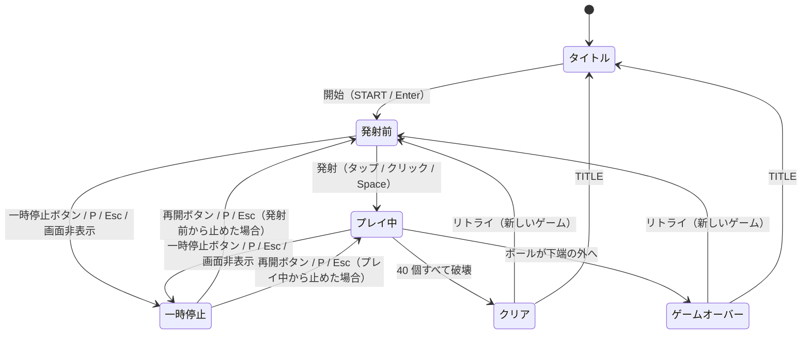

# ブロック崩しミニ 仕様書

- 版：1.4（2026-10-26）
- 対象：本リポジトリのブロック崩しゲーム「ブロック崩しミニ」（ゲーム本体 + 端末内ハイスコアランキング）
- 位置づけ：ゲームのルール・物理・画面・ランキングの規則を定める仕様。スマートフォンの縦画面で、ブラウザだけで動くアプリ（インストール可能・オフライン動作）として作る前提で書く

### 改訂履歴

| 版 | 日付 | 内容 |
| --- | --- | --- |
| 1.0 | 2026-10-23 | 初版（PC のキーボード・マウス操作、全プレイヤー共通のランキングサービス） |
| 1.1 | 2026-10-23 | スマートフォンの縦画面・タッチ操作を基準に変更。ランキングを端末内の保存に変更（サービス・通信をなくす）。記録の書き出し・読み込み、インストール・オフライン動作・更新の要件、効果音とそのオン / オフ設定を追加。ゲームのルール・物理・スコアは変更なし |
| 1.2 | 2026-10-25 | タッチ端末では、ゲーム領域の下に指で操作する「操作空間」を設ける（指でゲーム領域を隠さないため）。タイトル画面に、ランキングの記録を全部消すボタンを追加。ゲームのルール・物理・スコアは変更なし |
| 1.3 | 2026-10-25 | クレジット画面を追加（タイトル画面の RANKING の下の「クレジット」ボタンから）。ゲームのルール・物理・スコアは変更なし |
| 1.4 | 2026-10-26 | アプリの名前を「ブロック崩しミニ」に変更（ホーム画面の名前、ページタイトル、タイトル画面の見出し、ゲーム領域の代替テキスト）。アプリのバージョン（1.0.0）は変えない。ゲームのルール・物理・スコアは変更なし |

---

## 目次

1. [概要](#1-概要)
2. [フィールドと座標系](#2-フィールドと座標系)
3. [ゲームオブジェクト](#3-ゲームオブジェクト)
4. [操作仕様](#4-操作仕様)
5. [ゲームの進行と物理](#5-ゲームの進行と物理)
6. [スコア](#6-スコア)
7. [状態遷移](#7-状態遷移)
8. [画面仕様](#8-画面仕様)
9. [ハイスコアランキング](#9-ハイスコアランキング)
10. [非機能要件](#10-非機能要件)
11. [パラメータ一覧](#11-パラメータ一覧)
12. [受け入れ基準](#12-受け入れ基準)

---

## 1. 概要

1 ステージ・残機 1 のブロック崩しと、端末内に保存するハイスコアランキングで構成するゲームである。プレイヤーはパドルを左右に動かしてボールを打ち返し、40 個のブロックをすべて壊せばクリア、ボールを 1 回でも落とせばゲームオーバーとなる。

### 1.1 範囲

| 区分 | 内容 |
| --- | --- |
| 本仕様で定める | ゲームルール、物理と衝突判定、操作、画面と画面遷移、スコア計算、効果音、ランキングの登録・表示ルール、記録の書き出し・読み込み、インストール・オフライン動作・更新の要件、数値パラメータ |
| 実装者が選ぶ | 実装言語、描画 API、UI ライブラリ、端末内保存の方式、配置形態 |

### 1.2 前提

- **決定性**：ゲーム内に乱数はない。同じ入力列を同じタイミングで与えれば、同じ盤面とスコアになる（固定タイムステップで進めるため）。
- **ステージ・残機**：ステージは 1 つ、残機は 1。アイテム、耐久度のあるブロック、複数ボールはない。
- **通信しない**：サーバーを持たず、外部へデータを送らない。ランキングを含むすべての記録は、その端末（ブラウザ）の中だけに保存する。
- **想定する端末**：スマートフォンの縦画面を基準にする。タッチ操作で遊べることを必須とし、PC のマウス・キーボードでも遊べるようにする。
- **用語**
  - 論理座標：ゲーム内部の座標。単位は px。表示サイズに依存しない
  - ステップ：物理を 1 回進める単位時間（1/120 秒）
  - ポインタ：タッチ（指）・マウス・ペンをまとめた呼び方
  - タップ：ポインタを押してから離すまでの動きが小さい操作（§4.1-4）
  - 端末内保存：ブラウザに保存する仕組み（localStorage 等）。ブラウザの都合で消えることがある
  - アプリ識別子：同じサイトに載るほかのアプリと保存データを混ぜないための、このアプリ固有の名前

---

## 2. フィールドと座標系

ゲームは幅 480 × 高さ 640 の論理座標で動き、表示は縦横比 3:4 を保って拡大縮小する。物理計算はすべて論理座標で行う。

- 原点は左上、x は右向き、y は下向き。速度の単位は px/秒。
- 左壁 x = 0、右壁 x = 480、天井 y = 48（HUD 帯の下端）。**下端（y = 640）に壁はない。**

```
x=0                                        x=480
┌──────────────────────────────────────────┐ y=0
│ SCORE : 300                    TIME : 42 │  HUD 帯
├──────────────────────────────────────────┤ y=48（天井）
│                                          │
│  ■■ ■■ ■■ ■■ ■■ ■■ ■■ ■■                 │ y=88   1 行目
│  ■■ ■■ ■■ ■■ ■■ ■■ ■■ ■■                 │        …
│  ■■ ■■ ■■ ■■ ■■ ■■ ■■ ■■                 │ y=184  5 行目（下端 204）
│                                          │
│                    ●                     │  プレイ空間
│                                          │
│                ▀▀▀▀▀▀▀▀                  │ y=600〜612 パドル
│                                          │
└──────────────────────────────────────────┘ y=640（壁なし）

┌──────────────────────────────────────────┐
│                                          │  操作空間（タッチ端末だけ。§8.3）
└──────────────────────────────────────────┘

┌─────────────┐              ┌─────────────┐
│ 一時停止     │              │ 効果音：オン │  操作欄（§8.3）
└─────────────┘              └─────────────┘
```

| 領域 | y 範囲 | 内容 |
| --- | --- | --- |
| HUD | 0–48 | 左に `SCORE : <ブロック得点>`、右に `TIME : <経過秒（切り捨て）>` |
| ブロック帯 | 88–204 | 8 列 × 5 行のブロック |
| プレイ空間 | 204–600 | ボールが行き来する領域 |
| パドル | 600–612 | パドルはこの高さで左右にだけ動く |
| 落下域 | 612–640 | ここを通り越して下端の外に出たらミス |

**操作空間**：タッチ端末（主な入力が指の端末）では、ゲーム領域のすぐ下に、ゲーム領域と同じ幅・高さ 96 の「操作空間」を置く。ゲーム領域を指でなぞると、指でボールやパドルが隠れてしまうため、プレイ空間とは別に指を置く場所を設ける。操作空間はフィールド（論理座標）の外にあり、物理計算には関わらない。横方向の位置はゲーム領域と同じ変換（§2.1）で論理座標の x に直す。パソコン（マウス）では出さない。

### 2.1 表示サイズ

画面全体は最大幅 480 で中央寄せにする（§8.1）。ゲーム領域の表示サイズは次で決める。

- 利用可能幅 = min(画面幅, 480) − 32（左右の余白 16 ずつ）
- 利用可能高さ = 画面の表示領域の高さ − 上端の余白（安全領域を含む）− 操作空間（タッチ端末だけ。§2）の高さ − ゲーム領域の下の操作欄（§8.3）の高さ − 下端の安全領域
- 表示幅 = max(288, min(利用可能幅, 利用可能高さ × 3/4))
- 表示高さ = 表示幅 × 4/3
- 最小は論理サイズの 0.6 倍（288 × 384）。これより小さい画面では縦スクロールを許す（横スクロールは出さない）。最大は 448 × 約 597（画面幅 480 以上のとき）。
- 画面サイズや向きが変わったら即座に計算し直す。ただし **結果画面では、高さだけが変わった場合は計算し直さない**（名前入力でソフトウェアキーボードが出て表示領域が縮んでも、ゲーム領域が縮まないようにするため）。
- 高密度画面では実ピクセル密度に合わせて描画し、ぼやけさせない。
- ポインタ位置は「(画面上の x − 表示領域の左端) × 480 / 表示幅」で論理座標に変換する。

### 2.2 描画

毎フレーム全体を描き直す。描画順は次のとおり。

1. 背景（フィールド全面）
2. 外枠（線幅 2）
3. 生きているブロック
4. パドル
5. ボール
6. HUD（等幅太字 18、左右余白 16、上端 12。スコアは 3 桁区切り）
7. オーバーレイ
   - 発射前：「タップ / Space で発射」（中央より 80 下、14）
   - 一時停止中：フィールド全面に半透明の幕 +「PAUSED」（中央、太字 28）+「再開ボタン / P / Esc で再開」（中央より 36 下、14）

文字の大きさは論理座標での値。表示が縮小されても 0.6 倍（最小 14 × 0.6 ≒ 8.4px）までなので、読める大きさを保つ。

マウスで操作しているときは、ゲーム中のゲーム領域上のマウスカーソルを隠す。

---

## 3. ゲームオブジェクト

### 3.1 パドル

| 項目 | 値 |
| --- | --- |
| 幅 × 高さ | 80 × 12 |
| 上面の y | 600（固定） |
| 位置の持ち方 | 中心 x。初期値 240 |
| 移動範囲 | 中心 x を 40–440 に丸める（端が壁からはみ出さない） |
| 見た目 | 角丸半径 4 |

### 3.2 ボール

| 項目 | 値 |
| --- | --- |
| 半径 | 6 |
| 位置・速度 | 中心座標、速度ベクトル（px/秒） |
| 発射前 | パドル中央の真上（x = パドル中心、y = 600 − 6 − 1 = 593）に乗り、パドルに追従。速度 0 |

### 3.3 ブロック

- 8 列 × 5 行 = 40 個。各 幅 52 × 高さ 20、間隔 4。
- 左上座標：x = 18 + 列 × 56、y = 88 + 行 × 24（列・行は 0 始まり）。左右の余白はどちらも 18。
- ID = 行 × 8 + 列（0–39）。属性は生存フラグだけで、一度当たれば壊れる。
- 得点は行によらず 1 個 10 点。色だけ行ごとに変える。

### 3.4 配色（推奨）

暗い色で固定する（端末のライト / ダーク設定に合わせて変えない）。ブロックは行ごとに区別できれば変えてよい。

| 対象 | 色 |
| --- | --- |
| ブロック 1 行目（最上段） | #EF5350（赤） |
| ブロック 2 行目 | #FFA726（橙） |
| ブロック 3 行目 | #FFD54F（黄） |
| ブロック 4 行目 | #66BB6A（緑） |
| ブロック 5 行目 | #4FC3F7（青） |
| フィールド背景 | #050814 |
| 外枠 | #3A4468 |
| パドル | #E6EAF2 |
| ボール | #FFFFFF |
| HUD 文字 | #E6EAF2 |
| ヒント文字 | #A0AABF |
| 一時停止の幕 | rgba(11, 16, 32, 0.75) |
| 画面全体の背景（ゲーム領域の外）・テーマ色 | #0B1020 |
| 強調色（主ボタン） | #4FC3F7 |
| 強調色（合計スコア・上位 3 位・自分の記録） | #FFD54F |
| 成功（クリア） | #66BB6A |
| エラー（ゲームオーバー・入力エラー） | #FF6B6B |

---

## 4. 操作仕様

タッチで遊べることを基準とし、マウス・キーボードでも遊べる。パドルは「最後に使われた入力」に従う。キーは文字ではなく物理キー位置で判定する（キーボード配列や IME の状態に左右されない）。

| 操作 | タッチ | マウス・キーボード | 有効な状態 |
| --- | --- | --- | --- |
| パドル移動 | 操作空間またはゲーム領域を指でなぞる（押している間、指の x に追従） | マウス移動 / ← → / A D（押している間） | 発射前・プレイ中 |
| 発射 | 操作空間またはゲーム領域をタップ | ゲーム領域をクリック / Space | 発射前 |
| 一時停止・再開（トグル） | 一時停止ボタン | 一時停止ボタン / P / Esc | 発射前・プレイ中・一時停止中 |
| 自動一時停止 | 画面が非表示になる（アプリ切替え・タブ切替え・画面ロック等） | 同左 | 発射前・プレイ中 |
| 効果音のオン / オフ（トグル） | 効果音ボタン | 効果音ボタン | いつでも（ボタンがある画面） |
| 開始 | START ボタン | START ボタン / Enter | タイトル |
| リトライ | RETRY ボタン | RETRY ボタン / Enter | 結果 |
| タイトルへ戻る | BACK ボタン | BACK ボタン / Esc | ランキング・クレジット |

### 4.1 入力の細則

1. **キーボード移動**：向き dir = （右が押されていれば +1）−（左が押されていれば 1）。両方押しは停止。移動量 = dir × 420 px/秒 × ステップ時間。加速・慣性はない。
2. **ポインタ移動**：ポインタの x を論理座標に変換して 0–480 に丸め、パドル中心をその位置へ即座に合わせる（速度制限なし）。
   - タッチ・ペン：ゲーム領域内または操作空間内で押した時点から、離すまでの間だけ追従する。押した瞬間にもパドルを合わせる。押したまま指がその外に出ても、離すまで追従を続ける。ゲーム領域・操作空間の外（操作欄のボタンなど）で押した場合は追従しない。
   - マウス：ボタンを押していなくても、マウスを動かせば追従する。ポインタがゲーム領域の外にあっても追従する。
   - 複数の指が触れているときは、最初に触れた指だけを使う。
3. **入力元の切替え**：左右キーを押すと「キーボード」、ポインタを動かす（タッチなら押す・なぞる）と「ポインタ」が有効になる。どちらの場合もパドル中心は最後に 40–440 に丸める。
4. **発射要求**：
   - タップ・クリック：ゲーム領域内または操作空間内で押してから離すまでの移動が論理座標で 10 px 以内なら、離した時点で発射要求を出す。10 px を超えて動かした場合（パドルを動かした場合）は発射しない。これにより、発射前に指でパドルの位置を合わせてから、改めてタップで発射できる。
   - Space：押した時点で発射要求を出す。キーリピート（押しっぱなしによる自動連打）は無視する。
   - 発射要求は 1 回分だけ蓄え、次のステップで取り出したら消える。発射前以外での発射要求は何も起こさない。
5. **P / Esc** もキーリピートを無視する。
6. 一時停止時、ウィンドウがフォーカスを失ったとき、タッチが中断されたとき（OS による割り込み等）は、押下中の左右キーとタッチの追従をすべて「離した」扱いにする。再開時は一時停止中に出た発射要求を捨てる（再開した瞬間に発射しない）。
7. ゲーム中は ← → Space の既定動作（ページスクロール等）を抑止する。ゲーム領域と操作空間の上では、タッチによるスクロール・拡大・ダブルタップ拡大・長押しメニュー・文字選択を起こさない。ゲームが終わったらゲーム用の入力を受け付けるのをやめ、結果画面の操作を妨げない。
8. **結果画面の入力ガード**：結果画面が出てから 500 ミリ秒間は、Enter・Space と、結果パネル上のタップ・クリックを無効にする。プレイ中に押していたキーや指で、リトライや登録が意図せず動かないようにするためである。
9. **Enter の二重動作防止**：タイトル・結果画面で、ボタンや入力欄にフォーカスがあるときの Enter はその部品の動作だけを行い、画面全体の Enter（開始・リトライ）は動かさない。

---

## 5. ゲームの進行と物理

### 5.1 ゲームループ

- 物理は **固定タイムステップ 1/120 秒（約 8.333 ミリ秒）** で進める。描画はフレームごと（目標 60 fps）に 1 回。
- 各フレームで、前フレームからの実経過時間を蓄積器に足し、蓄積が 1 ステップ以上ある間ステップを繰り返す（浮動小数点誤差の許容値 1e-6 ミリ秒）。
- 1 フレームで足す実経過時間は **最大 100 ミリ秒** に制限する（復帰直後に大量のステップを進めてボールが物体をすり抜けるのを防ぐ）。
- ステップの途中で状態が発射前・プレイ中以外になったら、そのフレームの残りのステップは実行しない。
- ループは発射前・プレイ中の間だけ動かす。一時停止から再開するときは時刻の基準と蓄積器を初期化し、止まっていた時間を進めない。

### 5.2 1 ステップの処理順

状態が「発射前」「プレイ中」以外のときは何もしない。それ以外は次の順で処理する。

1. **パドル移動**（§4.1）
2. **発射前の場合**：ボールをパドル中央の真上（§3.2）に置く。発射要求があれば §5.3 の速度で発射し「プレイ中」へ移る。このステップはここで終わる（経過時間は増やさない）。
3. **プレイ中の場合**
   1. 経過時間にステップ時間を足す
   2. 現在の速さ `speed`（§5.8）を求める
   3. ボールを移動：位置 += 速度 × ステップ時間（秒）
   4. 壁との衝突（§5.4）
   5. パドルとの衝突（§5.5）。衝突した場合は最小垂直成分の補正（§5.7）を行う
   6. ブロックとの衝突（§5.6）
   7. 速度段階の更新（§5.8）
   8. クリア判定：壊したブロックが 40 個以上なら「クリア」。**クリアが成立したステップでは落下判定をしない**
   9. 落下判定：ボールの上端（y − 半径）が 640 を超えたら「ゲームオーバー」

### 5.3 発射

- 向きは垂直から右へ 20°（乱数なし）。
- 速度 = (speed × sin20°, −speed × cos20°)。初速 300 なら約 (102.61, −281.91)。

### 5.4 壁との衝突

向きは符号反転ではなく **絶対値で設定** する（境界付近で何度も反転して振動しないため）。

| 条件 | 位置の補正 | 速度 |
| --- | --- | --- |
| x − r < 0（左壁） | x = r | vx = \|vx\| |
| x + r > 480（右壁、左壁と排他） | x = 480 − r | vx = −\|vx\| |
| y − r < 48（天井） | y = 48 + r | vy = \|vy\| |

下端には壁がない。

### 5.5 パドルとの衝突

パドルの矩形 = (中心 x − 40, 600, 幅 80, 高さ 12)。重なりの判定は §5.9 の円と矩形の判定で行う。重なっていなければ何もしない。

**A. ボール中心 y ≤ 600（上面に当たった）**

- ボールが上向き（vy < 0）の場合：パドルが下から重なっただけなので、位置を y = 600 − r に押し出すだけで速度は変えない。
- それ以外：
  - offset = clamp((ボール x − パドル中心 x) / 40, −1, 1)
  - θ = offset × 60°
  - 速度 = (speed × sinθ, −speed × cosθ)、位置 y = 600 − r
  - 中央で真上、端ほど外向きに傾き、端で最大 60°。打ち返し前の向き・速さには依存しない。

**B. ボール中心 y > 600（側面・角に当たった）**

- ボールがパドル中心より左なら：x = パドル左端 − r、vx = −|vx|
- それ以外：x = パドル右端 + r、vx = |vx|
- vy はそのまま。

パドルと重なった場合は（A の押し出しだけの場合も含め）、最後に §5.7 の補正をかける。

### 5.6 ブロックとの衝突

1. 生きているすべてのブロックについて §5.9 の判定を行い、重なったブロックを集める。なければ終わり。
2. **重なったブロックはすべて同じステップで壊す**。壊した数 × 10 点をブロック得点に足す。
3. 反射は **最も深く重なった 1 個（代表ブロック）に対して 1 回だけ** 行う。深さが同じなら ID の小さい方を代表とする。
4. 代表ブロックに対するめり込み量 overlapX、overlapY（§5.9）で向きを決める。
   - overlapX ≤ overlapY なら **側面** として扱う
     - ボール x < ブロック中心 x なら x = ブロック左端 − r、vx = −|vx|
     - それ以外は x = ブロック右端 + r、vx = |vx|
   - overlapY ≤ overlapX なら **上下面** として扱う
     - ボール y < ブロック中心 y なら y = ブロック上端 − r、vy = −|vy|
     - それ以外は y = ブロック下端 + r、vy = |vy|
   - 両者が等しい（角）場合は両方を行う。
5. 最後に §5.7 の補正をかける（このときの speed は段階更新前の値）。

### 5.7 最小垂直成分の補正

ボールがほぼ水平に飛び続けるのを防ぐ。

- minVy = speed × 0.5（= cos60°）
- |vy| ≥ minVy なら何もしない。
- そうでなければ、
  - vy = 符号(vy) × minVy（vy < 0 なら −1、それ以外は +1）
  - vx = 符号(vx) × √(speed² − vy²)（vx < 0 なら −1、それ以外は +1）

速さは speed になり、各成分の符号は保たれる。

### 5.8 速度段階（加速）

| 壊したブロック数 | 段階 | 速さ（px/秒） |
| --- | --- | --- |
| 0–9 | 0 | 300 |
| 10–19 | 1 | 330 |
| 20–29 | 2 | 360 |
| 30–40 | 3 | 390 |

- 段階 = min(3, floor(壊した数 / 10))、速さ = 300 × (1 + 0.1 × 段階)
- 段階が変わったステップで、ボールの速度ベクトルを **向きを保ったまま** 新しい速さに合わせる。
- 1 ゲームの中で段階は下がらない。リトライで 0 に戻る。

### 5.9 円と矩形の重なり判定

中心 c、半径 r の円と、左上 (x, y)・幅 w・高さ h の矩形について次を求める。

- 最近点 n = (clamp(c.x, x, x + w), clamp(c.y, y, y + h))
- 距離 d = |c − n|
- **重なり = d < r**（接しているだけ、d = r は重なりに含めない）
- 深さ depth = r − d
- overlapX = min(c.x + r − x, x + w − (c.x − r))
- overlapY = min(c.y + r − y, y + h − (c.y − r))

---

## 6. スコア

| 項目 | 計算 |
| --- | --- |
| ブロック得点 | 壊したブロック数 × 10（0–400） |
| 経過時間 | プレイ中のステップでだけ増える。発射前・一時停止中は増えない |
| 時間ボーナス | クリア時：max(0, 180 − floor(経過ミリ秒 / 1000)) × 10。ゲームオーバー時は 0 |
| 合計スコア | ブロック得点 + 時間ボーナス（0–2,200） |

- 時間ボーナスの最大は 1,800（経過 1 秒未満でクリア）。180 秒以上かかると 0。
- HUD の SCORE はブロック得点を表示する（時間ボーナスは結果画面でだけ加算して見せる）。HUD の TIME は floor(経過ミリ秒 / 1000)。
- 得点はすべて 10 点単位になる。
- 数値は 3 桁区切りで表示する（例：1,250）。

**例**：95,789 ミリ秒でクリア → ブロック 400 + 時間ボーナス (180 − 95) × 10 = 850 → 合計 1,250。

---

## 7. 状態遷移

### 7.1 ゲームの状態



| 状態 | 説明 |
| --- | --- |
| タイトル | ゲームを始める前の画面 |
| 発射前 | ボールがパドルに乗っている。パドルは動かせる。経過時間は増えない |
| プレイ中 | ボールが動いている。経過時間が増える |
| 一時停止 | 物理も経過時間も止まる。どの状態から止めたかを覚え、再開時にその状態へ戻る |
| クリア / ゲームオーバー | ゲーム終了。結果画面を出す。物理は止まり、最後の盤面を暗く（不透明度 50%）表示し続ける |

### 7.2 規則

- 一時停止できるのは発射前とプレイ中だけ。それ以外での P / Esc は何もしない（ただしランキング画面の Esc は §8.4）。
- 画面が非表示になったときは「一時停止」にするだけで、表示に戻っても自動では再開しない。
- 「リトライ」「開始」は常に **新しいゲーム**（§3 の初期配置、得点・経過時間・速度段階 0）を作る。
- クリア判定はゲームオーバー判定より優先する（同じステップで両方の条件を満たしたらクリア）。
- ゲーム終了時には、結果・壊した数・ブロック得点・時間ボーナス・合計・経過ミリ秒をまとめた「結果サマリ」を作り、結果画面と登録に使う。
- 遊んでいる途中のゲームは保存しない。アプリを閉じたり読み込み直したりしたら、タイトルから始まる。

---

## 8. 画面仕様

画面は 5 つ。ゲーム・結果は同じ場所にあり、結果パネルはゲーム領域の上に重ねて表示する。

| 画面 | 入口 | ページタイトル |
| --- | --- | --- |
| タイトル | 起動時、結果画面の TITLE、ランキング・クレジットの BACK / Esc | ブロック崩しミニ - タイトル |
| プレイ | タイトルの START、結果画面の RETRY | ブロック崩しミニ - プレイ |
| 結果 | ゲーム終了 | ブロック崩しミニ - 結果 |
| ランキング | タイトル・結果画面の RANKING | ブロック崩しミニ - ランキング |
| クレジット | タイトルの「クレジット」（§8.8） | ブロック崩しミニ - クレジット |

存在しない画面へのアクセスはタイトルへ移す。

### 8.1 共通

- 画面全体は最大幅 480 で中央寄せ。暗い配色で固定（§3.4）。
- スマートフォンの縦画面を基準に作る。iPhone SE（幅 375）程度の小さい画面でも、横スクロールやはみ出しが出ないこと。
- ノッチ・ホームバー等の安全領域に内容が入り込まないよう、上下左右の余白に安全領域を含める。
- 横向きで、ゲーム領域が最小サイズ（§2.1）でしか表示できないときは、「縦向きでのプレイをおすすめします」と表示する（遊ぶことは妨げない）。
- ボタンは最小高さ 48（タップ領域 44 以上）。キーボードでも操作でき、フォーカス位置が見えること。
- ページ全体のピンチ拡大は許可する（ゲーム領域の上だけ §4.1-7 で抑止する）。
- 端末で「視差効果を減らす」が有効なときは、画面切替え等の装飾的なアニメーションを無効にする（ゲームの動きそのものは対象外）。

### 8.2 タイトル画面

- 見出し「ブロック崩しミニ」
- ボタン：START（PC では Enter のヒント付き。初期フォーカス）、RANKING、その下に「クレジット」（§8.8）
- 操作方法の一覧
  - パドル移動：画面の下をなぞる ／ マウス ／ ← → ・ A D
  - 発射：タップ ／ クリック ／ Space
  - 一時停止：一時停止ボタン ／ P ・ Esc
- 効果音ボタン（§8.7）
- **記録を全部消すボタン**（§9.2）：押すと確認を出し、「消す」を選んだらランキングの記録をすべて消す。取り消したら何も変えない。消し終わったら「記録を消しました」、書き込めなかったら「消せませんでした。もう一度お試しください」と表示する
- アプリのバージョン（例：`v1.0.0`）
- インストール方法の説明への入口（§8.6）

### 8.3 プレイ画面・結果画面

- タッチ端末では、ゲーム領域のすぐ下に **操作空間**（§2）を置く。なぞるとパドルが動き、タップで発射する（§4.1）。何をする場所か分かるよう、薄い文字で「ここをなぞって移動・タップで発射」と出す。
- ゲーム領域（タッチ端末では操作空間）の下に操作欄を置き、**一時停止ボタン** を出す。押すたびに一時停止と再開を切り替え、表示も「一時停止」⇔「再開」に変える。発射前・プレイ中・一時停止中だけ押せる。
- 操作欄には効果音ボタン（§8.7）も置く。押してもゲームは一時停止しない。
- ゲーム終了でゲーム領域を暗くし、その上に **結果パネル** を重ねて出す。パネルがゲーム領域に収まらないときは、パネルの中をスクロールできるようにする。

**結果パネル**

| 要素 | クリア | ゲームオーバー |
| --- | --- | --- |
| 見出し | 「CLEAR!」（成功色・アイコン付き） | 「GAME OVER」（エラー色・アイコン付き） |
| ブロック | ブロック得点 | — |
| 時間ボーナス | 時間ボーナス | — |
| 合計 | 合計スコア（大きく、強調色） | 合計スコア（大きく、強調色） |
| タイム | 経過秒を小数第 1 位で切り捨て（例：95,789 ms → 95.7 秒） | — |
| 壊したブロック | `n / 40` | `n / 40` |

- スコア登録エリア（§9.5）
- ボタン：RETRY（PC では Enter のヒント付き）、TITLE、RANKING
- 結果パネルは §4.1-8 の入力ガードを持つ。

### 8.4 ランキング画面

- 見出し「ハイスコアランキング」（初期フォーカス）
- この端末で登録した記録の上位 10 件の表。列：順位 / 名前 / スコア / 結果 / 登録日時

| 列 | 表示 |
| --- | --- |
| 順位 | 1–3 位は「1st」「2nd」「3rd」を強調色で、4 位以下は数字 |
| 名前 | 長い場合は省略記号で切り、全文は長押し・ツールチップ等で見られる |
| スコア | 3 桁区切り、右寄せ |
| 結果 | 「CLEAR」または「GAME OVER」。色だけでなくアイコンと文字で区別する |
| 登録日時 | 端末のタイムゾーンで `YYYY/MM/DD HH:mm`（24 時間制） |

- 画面幅が足りないときは、登録日時を名前の下に小さく表示するなど、行を 2 段にしてよい（横スクロールは出さない）。
- **自分の記録**：この端末で直前に登録した記録（§9.5 で保存した id）と一致する行を背景色と左端の帯で強調し、名前の後ろに「（あなた）」を付ける。
- 状態別の表示
  - 読み込み失敗（端末内保存が使えない等）：「ランキングを読み込めませんでした」+「再読み込み」ボタン
  - 0 件：「まだ記録がありません」+「タイトルへ戻る」ボタン
- 記録のバックアップ（§9.6）：「記録を書き出す」「記録を読み込む」ボタン
- BACK ボタンまたは Esc でタイトルへ戻る。
- 画面を開くたびに端末内保存から読み直す。

### 8.5 アクセシビリティ

- ゲーム領域には「ブロック崩しミニのゲーム画面」という代替テキストを付ける。
- 一時停止ボタンと効果音ボタンは、押された状態（一時停止中か・効果音がオンか）を支援技術に伝える。
- 効果音だけで情報を伝えない。効果音で知らせる出来事は、画面表示か読み上げでも分かるようにする。
- 次の出来事を支援技術向けに読み上げる（画面上には出さない通知領域を使う）。
  - スコアが変わった：「スコア 120」
  - 一時停止：「一時停止しました。再開ボタンで再開します」／再開：「再開しました」
  - ゲーム終了：「クリア。スコア 1,250」／「ゲームオーバー。スコア 120」
- 利用者が入力した文字（名前）は、文字として表示し、HTML として解釈させない。

### 8.6 インストール・オフライン・更新

- **インストール可能**：ホーム画面に追加してアプリのように開ける（名前「ブロック崩しミニ」・アイコン・テーマ色を持つ）。
- **オフライン動作**：一度開いたあとは、通信がなくても起動から登録・ランキング表示まで、すべての機能が使える。外部のリソース（Web フォント・外部のスクリプト等）に頼らない。
- **インストール方法の入口**：タイトル画面に置く。iPhone / iPad（Safari：共有 → ホーム画面に追加）、Android（Chrome：メニュー → アプリをインストール）、パソコン（Chrome / Edge：アドレスバーのインストールのマーク）の 3 つの手順を載せ、今使っている端末の説明を最初から開いておく。ブラウザがインストールの案内に対応しているときは「今すぐインストール」ボタンも出す。すでにインストールしたアプリとして開いているときは、入口を出さない。
- **更新**：新しい版が届いても勝手に切り替えず、「更新」ボタンを出して利用者が切り替える。プレイ中に画面が読み込み直されることはない。
- **バージョン表示**：タイトル画面にバージョンを出し、更新が反映されたかをひと目で確認できるようにする。
- **起動失敗からの復旧**：古いキャッシュとの食い違い等で起動できなかったときは、このアプリのキャッシュだけを消して読み込み直す。保存データ（ランキング等）は消さない。

### 8.7 効果音

ゲーム中の出来事を短い効果音で知らせる。音はアプリの中で合成し、音声ファイルを持たない（オフラインで確実に鳴らすため。素材のライセンスの心配もなくなる）。

**鳴らす出来事**

| 出来事 | きっかけ | 音の印象（目安） |
| --- | --- | --- |
| 発射 | 発射前 → プレイ中（§5.2-2） | 短く上がる音 |
| パドルで打ち返す | パドルとの衝突（§5.5）。押し出しだけ（A の vy < 0）の場合は鳴らさない | 低めの「ポン」 |
| 壁・天井で跳ね返る | 壁との衝突（§5.4） | ごく短く小さい「コッ」 |
| ブロックを壊す | ブロックとの衝突（§5.6） | 高めの「カン」。行ごとに音の高さを変え、上の行ほど高くする |
| 加速 | 速度段階が上がった（§5.8） | 短い 2 音の上昇 |
| クリア | 状態がクリアになった | 明るい短いフレーズ（1 秒程度） |
| ゲームオーバー | 状態がゲームオーバーになった | 下がっていく短いフレーズ（1 秒程度） |
| 登録成功 | スコア登録に成功した（§9.5） | 短い確認音 |

**規則**

- 1 ステップ（§5.2）の中で同じ種類の出来事が何回起きても、その種類の音は 1 回だけ鳴らす（例：2 個のブロックを同時に壊しても「カン」は 1 回。高さは代表ブロックの行で決める）。
- 1 フレームの中で複数のステップが進んだ場合も、同じ種類の音はそのフレームで 1 回だけにする（音が重なって大きくなりすぎないため）。
- 同じステップで加速とブロック破壊が起きたら両方鳴らす。クリア・ゲームオーバーが起きたステップでは、ほかの音は鳴らさずクリア・ゲームオーバーの音だけを鳴らす。
- 効果音は物理と得点に影響しない。鳴らせない環境（音の機能が使えない・初期化に失敗した）でも、ゲームはそのまま動く。
- 一時停止したとき、画面が非表示になったときは、鳴っている音を止める。
- 音量は控えめにそろえる。端末の音量に従い、アプリ内の音量調整は設けない。
- スマートフォンのブラウザは、利用者が画面に触れるまで音を出せないことがある。最初のタップ・クリック・キー入力（START ボタン等）のときに音の機能を使える状態にする。

**オン / オフ設定**

- 効果音ボタンで、オンとオフを切り替える。表示は「効果音：オン」／「効果音：オフ」とし、アイコンだけにしない。
- 置き場所：タイトル画面と、プレイ画面の操作欄（§8.3）。
- 初期値はオン。設定は端末内に保存し、次に開いたときも引き継ぐ。保存できなくても、そのとき開いている間は設定が効く。
- オフに切り替えたら、鳴っている音もすぐに止める。
- この設定は記録のバックアップ（§9.6）には含めない。

### 8.8 クレジット画面

- タイトル画面の RANKING の下の「クレジット」ボタンで開く。
- 見出し「クレジット」（初期フォーカス）。BACK ボタンまたは Esc でタイトルへ戻る。
- 次の役職と名前を、上から順に中央揃えで表示する（役職ごとに間を空ける）。

| 役職 | 名前 |
| --- | --- |
| PRODUCER | YOSHIHARU TSUKUDA |
| DIRECTOR | YOSHIHARU TSUKUDA |
| GAME DESIGNER | YOSHIHARU TSUKUDA |
| GRAPHIC DESIGNER | CLAUDE CODE |
| SOUND CREATOR | CLAUDE CODE |
| PROGRAMMER | CLAUDE CODE |

- 文字は文字として表示する（画像にしない。読み上げで読めるようにするため）。

---

## 9. ハイスコアランキング

ランキングは端末内保存に置き、その端末（ブラウザ）で遊んだ記録だけを扱う。ほかの端末やほかの人とは共有しない。

### 9.1 記録のデータ項目

| 項目 | 型 | 制約 |
| --- | --- | --- |
| id | 整数 | 端末内で採番。1 から始まり、登録のたびに 1 増える一意の値（記録が消えても番号は再利用しない） |
| playerName | 文字列 | 前後の空白を除いて 1–12 文字（§9.3） |
| score | 整数 | 0–2,200 |
| result | 列挙 | `cleared` または `gameOver` |
| createdAt | 日時 | 登録時の端末の時刻。ミリ秒精度、UTC、ISO 8601 の文字列で保存 |

保存するもの：

| 名前 | 内容 |
| --- | --- |
| 記録一覧 | 上位 10 件まで（§9.4 の並び順） |
| 次の id | 次に採番する id |
| 前回の名前 | 最後に登録に成功した名前（§9.5 の初期値） |
| 自分の記録 id | 最後に登録した記録の id（§8.4 の「あなた」表示） |

ランキングとは別に、効果音のオン / オフ設定（§8.7）も端末内に保存する。

- 保存データには版番号を持たせる。保存の形を変えるときは版を上げ、古い形のデータを新しい形に移行する（古い記録を捨てない）。
- 保存の名前（キー）にはアプリ識別子を付け、同じサイトに載るほかのアプリと混ざらないようにする。
- 端末の時刻が戻されると、日時の順序が実際の登録順とずれることがある。並び順は §9.4 のとおり id で決着するので、壊れはしない。

### 9.2 操作

| 操作 | 入力 | 結果 |
| --- | --- | --- |
| 登録 | 名前、結果サマリ（score、result） | 記録を作って順位を求め、上位 10 件に入れば保存する。順位（または圏外）を返す |
| 上位取得 | なし | 並び順のとおりに最大 10 件。各要素は記録 + rank（1 始まりの連番）。0 件なら空の一覧 |
| 書き出し・読み込み | §9.6 | §9.6 |
| 全消去 | なし | 記録一覧を空にし、自分の記録 id を消す。次の id・前回の名前・効果音の設定は残す（id は再利用しないため）。書き込めなかったら、何も変えずに失敗を返す |

### 9.3 入力の規則

画面での入力と、記録の読み込み（§9.6）の両方で同じ規則を使う。

**名前**

1. 前後の空白を除く。
2. 文字数は **Unicode コードポイント単位** で数える（「𠮷」も 1 文字）。
3. 0 文字 → `empty`（「名前を入力してください」）
4. 制御文字（Unicode 一般カテゴリ Cc）または書式文字（Cf：ゼロ幅文字、結合子、方向制御など）を含む → `invalidChar`（「使用できない文字が含まれています」）
5. 12 文字を超える → `tooLong`（「12 文字以内で入力してください」）
6. 判定順は 3 → 4 → 5。保存するのは空白を除いた後の値。

**スコア**

- 0–2,200 の整数
- result は `cleared` / `gameOver` のどちらか
- **結果との整合性**（読み込むファイルの書き換えを見つけるため）
  - 10 の倍数であること
  - `gameOver` なら 400 以下（時間ボーナスがないため）
  - `cleared` なら 400 以上（全ブロックを壊しているため）

### 9.4 順位の決め方

- 並び順：score 降順 → createdAt 昇順（同点なら先に登録した方が上）→ id 昇順。
- 登録時の順位 = 「保存済みの記録のうち、自分より上位の記録数」+ 1。上位とは次のいずれか。
  - score が自分より高い
  - score が同じで createdAt が自分より前
  - score と createdAt が同じで id が自分より小さい
- 順位が 10 以内なら記録一覧に入れ、11 位以下になった記録を一覧から外す。順位が 11 以上なら記録一覧には入れない（圏外）。

### 9.5 結果画面のスコア登録

- クリア・ゲームオーバーのどちらでも登録できる。登録は任意。
- 名前入力欄と REGISTER ボタン。PC では入力欄に初期フォーカスを置き、カーソルを末尾にする。スマートフォンでは、画面を開いただけでソフトウェアキーボードが出ないよう、入力欄に自動でフォーカスを置かない。
- 入力欄の初期値は、この端末で前回登録に成功した名前（なければ空）。
- 補助表示：通常は「1〜12 文字」、右側に `現在の文字数 / 12`（前後の空白を除いて数える）。
- エラー表示：規則違反を入力中に即時表示する。ただし `empty` は、一度入力欄からフォーカスが外れた後にだけ表示する。
- 規則を満たさない間と登録済みの間は REGISTER を押せない。
- **二重登録の防止**：登録に成功したら入力欄とボタンを無効にし、同じ結果を再登録できない。
- 成功時：
  - 10 位以内：「n 位で登録しました」
  - 圏外：「ランキング外でした（上位 10 件に入りませんでした）」
  - どちらの場合も、RETRY ボタンにフォーカスを移し、「前回の名前」を保存する。10 位以内のときは「自分の記録 id」も保存する。
- 失敗時（端末内保存が使えない・容量不足等）：
  - 「保存できませんでした。もう一度お試しください」を表示し、再度 REGISTER を押せる。
  - ゲームそのものは続けて遊べる。

### 9.6 記録の書き出し・読み込み（バックアップ）

端末内保存はブラウザの都合で消えることがある（特に iPhone）ため、記録をファイルに書き出して保管し、読み込んで戻せるようにする。

**書き出し**

- ランキング画面の「記録を書き出す」で、JSON ファイルを端末に保存する。ファイル名は `<アプリ識別子>-backup-YYYYMMDD.json`（日付は端末のタイムゾーン）。
- 中身の例：

```json
{
  "app": "<アプリ識別子>",
  "schemaVersion": 1,
  "exportedAt": "2026-10-23T03:15:00.123Z",
  "nextId": 43,
  "lastPlayerName": "TSUKU",
  "lastRecordId": 42,
  "scores": [
    { "id": 42, "playerName": "TSUKU", "score": 1250, "result": "cleared",
      "createdAt": "2026-10-23T03:15:00.123Z" }
  ]
}
```

**読み込み**

- ランキング画面の「記録を読み込む」でファイルを選ぶ。今の記録は **置き換わる** ので、「今の記録は置き換わります。読み込みますか？」と確認してから行う。
- 次の場合は読み込まず、理由を表示する。今の記録は変えない。

| 状況 | 表示 |
| --- | --- |
| JSON として読めない・必須の項目がない | 「記録のファイルとして読み込めませんでした」 |
| `app` がこのアプリの識別子と違う | 「別のアプリの記録です」 |
| `schemaVersion` がこのアプリの版より新しい | 「新しい版のアプリで書き出した記録です。アプリを更新してから読み込んでください」 |
| 記録の 1 件でも §9.3 の規則に合わない、id が重複している | 「記録の内容が正しくありません」 |

- `schemaVersion` が古い場合は、§9.1 の移行をしてから読み込む。
- 記録が 10 件を超えていたら、§9.4 の並び順で上位 10 件だけを残す。
- `nextId` が記録の最大 id 以下なら、最大 id + 1 にそろえる。
- 成功したら「記録を読み込みました（n 件）」を表示し、ランキングの表を読み直す。

---

## 10. 非機能要件

| 項目 | 目標 |
| --- | --- |
| フレームレート | 一般的なスマートフォン（例：iPhone SE 第 2 世代、Pixel 7）とデスクトップの最新ブラウザで、プレイ中 60 fps を維持する（最高速度・スコア更新中も） |
| 物理の安定性 | 表示フレームレートが変わっても、物理は 1/120 秒刻みで同じ結果になる |
| 入力の遅れ | 指やマウスを動かしてから、パドルの表示が追いつくまで 1 フレーム以内 |
| 入力デバイス | タッチ（必須）、マウス・キーボード（対応） |
| 効果音の遅れ | 出来事が起きてから音が鳴るまで、体感で遅れを感じない（目安 50 ミリ秒以内） |
| 対応ブラウザ | iPhone の Safari、Android の Chrome、パソコンの Chrome / Edge の最新版 |
| オフライン | 一度開いたあとは、通信なしですべての機能が動く（§8.6） |
| 通信・個人情報 | 外部へデータを送らない。名前は端末の中にだけ保存する |
| 端末内保存の失敗 | 端末内保存が使えない・容量超過でも、ゲームは遊べる（登録・ランキングは §8.4・§9.5 のエラー表示になる） |

---

## 11. パラメータ一覧

| 名前 | 値 | 単位 | 説明 |
| --- | --- | --- | --- |
| FIELD_WIDTH | 480 | px | フィールド幅 |
| FIELD_HEIGHT | 640 | px | フィールド高さ |
| HUD_HEIGHT | 48 | px | HUD 帯の高さ（天井の y） |
| STEP | 1000/120 | ms | 固定タイムステップ |
| MAX_FRAME | 100 | ms | 1 フレームで進める時間の上限 |
| PADDLE_WIDTH | 80 | px | パドル幅 |
| PADDLE_HEIGHT | 12 | px | パドル高さ |
| PADDLE_Y | 600 | px | パドル上面の y |
| PADDLE_SPEED | 420 | px/秒 | キーボード操作時のパドル速度 |
| BALL_RADIUS | 6 | px | ボール半径 |
| BALL_INITIAL_SPEED | 300 | px/秒 | 初速 |
| LAUNCH_ANGLE | 20 | 度 | 発射角（垂直から右へ） |
| MAX_BOUNCE_ANGLE | 60 | 度 | パドル端での最大反射角（垂直から） |
| MIN_VY_RATIO | 0.5 | — | 速さに対する垂直成分の最小比 |
| BLOCK_COLS × BLOCK_ROWS | 8 × 5 | 個 | ブロック配置（計 40） |
| BLOCK_WIDTH × BLOCK_HEIGHT | 52 × 20 | px | ブロック寸法 |
| BLOCK_GAP | 4 | px | ブロック間隔 |
| BLOCK_OFFSET_X | 18 | px | 1 列目の左端 |
| BLOCK_OFFSET_Y | 88 | px | 1 行目の上端 |
| POINTS_PER_BLOCK | 10 | 点 | ブロック 1 個の得点 |
| SPEED_STEP_BLOCKS | 10 | 個 | 加速する破壊数の刻み |
| SPEED_STEP_RATIO | 0.1 | — | 1 段階あたりの加速率（初速比） |
| MAX_SPEED_LEVEL | 3 | — | 速度段階の上限 |
| TIME_BONUS_BASE | 180 | 秒 | 時間ボーナスの基準秒数 |
| TIME_BONUS_PER_SEC | 10 | 点 | 1 秒あたりの時間ボーナス |
| MAX_SCORE | 2,200 | 点 | 合計スコアの上限 |
| TAP_MAX_MOVE | 10 | px（論理） | タップとみなす、押してから離すまでの最大移動量 |
| RESULT_INPUT_GUARD | 500 | ms | 結果画面で Enter・Space・タップを無効にする時間 |
| CONTROL_AREA_HEIGHT | 96 | px（画面） | 操作空間の高さ（タッチ端末だけ） |
| PLAYER_NAME_MAX | 12 | 文字 | 名前の最大文字数（コードポイント） |
| RANKING_LIMIT | 10 | 件 | 保存・表示するランキングの件数 |
| PAGE_MAX_WIDTH | 480 | px（画面） | 画面全体の最大幅 |
| PAGE_GUTTER | 16 | px（画面） | ゲーム領域の左右の余白 |
| MIN_TAP_TARGET | 44 | px（画面） | タップできる部品の最小の大きさ |
| DISPLAY_MIN_SCALE | 0.6 | — | 表示の最小倍率 |
| SOUND_DEFAULT | オン | — | 効果音の初期設定 |

---

## 12. 受け入れ基準

再現実装は、次をすべて満たすこと。

### 12.1 ゲーム

- [ ] 開始直後、パドル中心 x = 240、ボール中心 (240, 593)、ブロック 40 個、得点 0、TIME 0
- [ ] 発射前はボールがパドルに追従し、TIME が増えない
- [ ] 発射直後の速度が約 (102.61, −281.91) px/秒
- [ ] パドル中央で打ち返すと真上、端で打ち返すと垂直から 60° に飛ぶ
- [ ] 左右の壁と天井（y = 48）で跳ね返り、下端では跳ね返らない
- [ ] パドルを左右の壁より外に出せない（中心 40–440）
- [ ] 2 個のブロックに同時に触れたら 2 個とも壊れ、20 点入り、反射は 1 回だけ
- [ ] 10・20・30 個目を壊した時点で速さが 330・360・390 px/秒になり、向きは変わらない
- [ ] ボールの垂直成分の大きさが常に速さの 0.5 倍以上
- [ ] 40 個壊すとクリア、ボールが下端の外に出るとゲームオーバー
- [ ] 最後のブロックを壊したステップでボールが下端の外に出ても、クリアになる
- [ ] 同じ入力列から同じ結果になる（乱数がない）

### 12.2 操作

- [ ] ゲーム領域を指でなぞるとパドルが指の x に追従し、指を離すと止まる
- [ ] タッチ端末では、ゲーム領域の下に操作空間が出て、そこをなぞってもパドルが指の x に追従し、タップで発射できる。パソコンでは操作空間が出ない
- [ ] 発射前に指でパドルを動かして離しても発射されず、そのあとのタップで発射される
- [ ] ゲーム領域・操作空間を指でなぞっている間、ページがスクロール・拡大しない
- [ ] マウス・← → / A D でもパドルを動かせ、最後に使った入力に従う
- [ ] Space の押しっぱなしで連続発射されない
- [ ] 一時停止ボタン・P / Esc で一時停止・再開でき、一時停止中は TIME が増えない
- [ ] 別のアプリやタブに切り替えると自動で一時停止し、戻っても自動では再開しない
- [ ] 一時停止中に Space を押しても、再開した瞬間に発射されない
- [ ] 結果画面の表示から 500 ms 以内の Enter・Space・タップではリトライ・登録が動かない

### 12.3 スコア・結果

- [ ] 95,789 ms でクリアすると、ブロック 400、時間ボーナス 850、合計 1,250、タイム 95.7 秒と表示される
- [ ] 180 秒以上かかったクリアの時間ボーナスが 0
- [ ] ゲームオーバーの合計がブロック得点と等しく、時間ボーナス・タイムの行が出ない

### 12.4 ランキング

- [ ] 名前「 TSUKU 」は「TSUKU」として登録される
- [ ] 13 文字の名前、空の名前、ゼロ幅文字を含む名前は登録できない
- [ ] 「𠮷」を 12 個並べた名前は登録できる
- [ ] 同点の記録は先に登録した方が上位になり、登録時に表示する順位とランキング画面の順位が一致する
- [ ] 10 件ある状態で 10 位の記録より低いスコアを登録すると「ランキング外でした」と表示され、一覧は変わらない
- [ ] 10 件ある状態で上位に入る記録を登録すると、元の 10 位が一覧から外れる
- [ ] 登録成功後は同じ結果を再登録できず、「n 位で登録しました」が出る
- [ ] ランキング画面で直前に登録した記録に「（あなた）」が付く
- [ ] アプリを閉じて開き直しても、ランキングと前回の名前が残っている
- [ ] 0 件・読み込み失敗の各表示が出る
- [ ] 端末内保存が使えない状態でも、ゲームを最後まで遊べ、登録時に「保存できませんでした」が出る
- [ ] タイトル画面の「記録を全部消す」で確認を出し、「消す」でランキングが 0 件になる。取り消すと何も変わらない。前回の名前と効果音の設定は残る

### 12.5 記録のバックアップ

- [ ] 書き出したファイルを読み込むと、同じランキングと「（あなた）」表示に戻る
- [ ] 別のアプリのファイル、新しすぎる版のファイル、壊れたファイルは、理由を表示して読み込まず、今の記録も変わらない
- [ ] score 401 + gameOver、score 390 + cleared、score 1,255 を含むファイルは「記録の内容が正しくありません」で読み込まない
- [ ] 読み込みの前に確認が出て、取り消すと何も変わらない

### 12.6 効果音

- [ ] 発射・パドル・壁・ブロック・加速・クリア・ゲームオーバー・登録成功で、それぞれの効果音が鳴る
- [ ] 2 個のブロックを同時に壊しても、ブロックの音は 1 回だけ鳴る
- [ ] 最後のブロックを壊したステップでは、クリアの音だけが鳴る
- [ ] 効果音ボタンでオフにすると、以後どの出来事でも鳴らず、鳴っている音も止まる
- [ ] 効果音の設定は、アプリを開き直しても引き継がれる
- [ ] 初めて開いたときの効果音はオン
- [ ] 音の機能が使えない環境でも、ゲームを最後まで遊べる

### 12.7 画面・インストール

- [ ] 幅 375 × 高さ 667（iPhone SE 相当）と幅 412 × 高さ 915（Pixel 7 相当）の縦画面で、横スクロールやはみ出しがなく、ゲーム領域・操作空間・一時停止ボタンが 1 画面に収まる
- [ ] 結果画面で名前を入力するためにソフトウェアキーボードが出ても、ゲーム領域の大きさが変わらない
- [ ] タップできる部品がすべて 44 px 以上
- [ ] タイトル画面にバージョンとインストール方法の入口が出る（インストールしたアプリとして開いたときは入口が出ない）
- [ ] 一度開いたあと、通信を切っても起動・プレイ・登録・ランキング表示ができる
- [ ] 新しい版を公開しても、プレイ中に画面が切り替わらず、「更新」ボタンを押すと新しい版になる
- [ ] タイトル画面の「クレジット」でクレジット画面が開き、§8.8 の役職と名前が中央揃えで出る。BACK・Esc でタイトルに戻る
